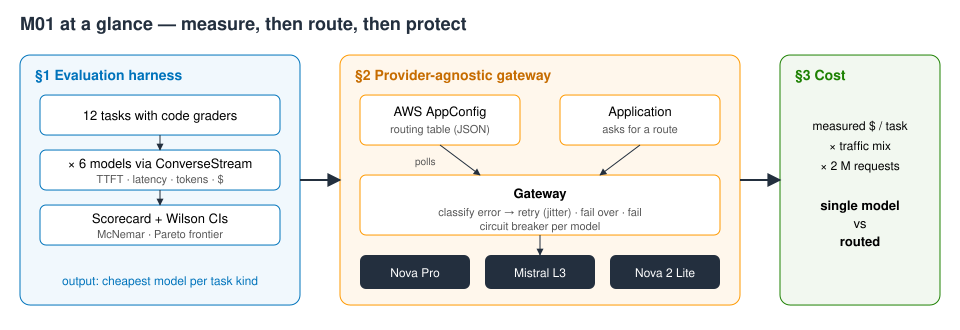
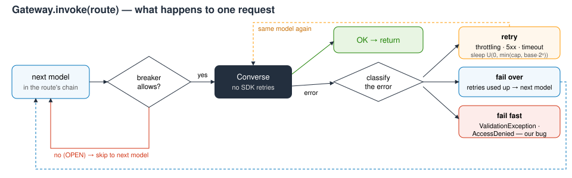
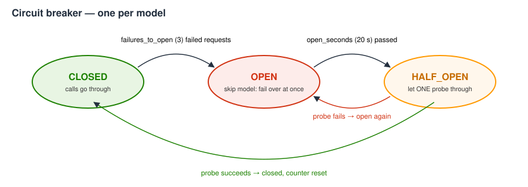

# M01 — Foundation Model Selection and Configuration · hands-on demo
**Evaluate, abstract, protect**

**Accompanies:** course deck module 1 (Foundation Model Selection and Configuration), slides 7–45, with slides 60–69 for the cost section · **Services used:** Amazon Bedrock (Converse / ConverseStream; Nova Micro, Nova 2 Lite, Nova Pro, Llama 3.3 70B, Mistral Large 3, gpt-oss-120b), AWS AppConfig (+ AppConfigData), optionally Bedrock prompt routers in the console · **Cost per run:** ≈ $0.01 (≈ 80 model calls ≈ $0.006, plus a few AppConfig deployments) · **Duration:** notebook ≈ 20 min, console ≈ 15 min · **Prep:** none beyond §0 (≈ 2 s); the notebook creates its AppConfig application itself in the first cell of §2

> **How this guide was verified.** The notebook was run end to end, live, in us-east-1 in October 2026; every **Expect** below is a range measured over several of those runs. The console steps in Part 2 were checked through the equivalent API calls (the models, inference profiles and AppConfig objects exist and behave as described), but the console pages, fields and buttons were **not** clicked through — labels may differ slightly from what you see. Model answers vary from run to run, so treat every number as a range, not a target.

**Reading the notebook.** The lines worth studying carry a `# ▶ KEY` comment, and every section uses the same four boxes: 💡 **Concept** (the idea before the code), 🔑 **Key code** (where to look), 📊 **How to read this** (how to interpret the output) and ✅ **Takeaway** (the one sentence to keep). A **Summary** table at the end lists what you built.

## What you will learn
- How to build a small **evaluation harness** on the Converse / ConverseStream API: one request shape for six models from four providers, graded by code, with time to first token (TTFT), p50/p95 latency and dollars per 1,000 tasks.
- How to read an eval **with error bars**: Wilson 95 % intervals, a paired McNemar test, and a cost/quality **Pareto frontier** that tells you which models you never need to consider for this workload.
- How to write a **provider-agnostic gateway**: the application asks for a *route*, a routing table in **AWS AppConfig** maps the route to an ordered list of models, and the gateway decides per error whether to retry, fail over or fail — with jittered backoff and a **circuit breaker**.
- How to turn the measured cost per task into a **monthly projection** for a routed workload.



## Before you start
1. **Set up the environment** once, from the repository root (needs [uv](https://docs.astral.sh/uv/)):
   ```bash
   ./setup_env.sh
   .venv/bin/jupyter lab notebooks/
   ```
   Open [`../notebooks/M01_evaluate_abstract_protect.ipynb`](../notebooks/M01_evaluate_abstract_protect.ipynb) with the kernel **MLAIDP (Python 3.12)**.
2. **Credentials:** the notebook uses the standard AWS credential chain in **us-east-1**. If you use a named profile, set `AWS_PROFILE` before starting Jupyter. Your identity needs Bedrock invoke rights and AppConfig / AppConfigData create, deploy, read and delete rights.
3. **Model access** (Bedrock → Model access, us-east-1): `us.amazon.nova-micro-v1:0`, `us.amazon.nova-2-lite-v1:0`, `us.amazon.nova-pro-v1:0`, `us.meta.llama3-3-70b-instruct-v1:0`, `mistral.mistral-large-3-675b-instruct`, `openai.gpt-oss-120b-1:0`. For the optional prompt router in Part 2 also Llama 3.1 8B and 70B. No step needs Anthropic Claude.
4. **Quotas:** the 72-call evaluation runs four calls at a time to stay inside small on-demand quotas. If your account is shared with other running notebooks you may see throttling errors (see §1).
5. **Do not use Run All.** The last section is the cleanup; Part 2 step 5 needs the AppConfig application the notebook creates.

§0 prints a banner with your account (shortened), the Region and a run id. It takes about 2 s.

## Part 1 — the notebook
In total the cells take about 2 minutes of compute; two cells in §2 wait on purpose (≈ 27 s and ≈ 55 s) and print nothing until they finish.

### §1 An evaluation harness: measure, don't guess · slides 7–14
**What the code does:** defines twelve support-desk tasks for AnyCompany Insurance — four email classifications, three field extractions, three amounts computed from a short home-policy summary, a deadline question and a question the policy does not answer. Every task has a **grader written in code** (first word for labels, last number for amounts, exact JSON fields). `converse_measured` sends one prompt through **ConverseStream**, records the time to the first text chunk and the total time, and reads the token usage from the final `metadata` event. Then all 12 tasks run on all 6 models — 72 calls, four in parallel.

**What to look for:**
- The same `converse_stream(...)` call works unchanged for Amazon, Meta, Mistral AI and OpenAI models. That uniform request shape is what makes the gateway in §2 possible.
- TTFT and total latency are different numbers: a chat window "feels" the first token, a batch job only cares about the total.
- If you cannot write a grader for a task, you need a judge model instead (module 9).

**Key code to read:** in `converse_measured`, the three `# ▶ KEY` lines — the single `converse_stream(...)` call where only `modelId` differs between providers, the first `contentBlockDelta` that stops the TTFT clock, and the `metadata` event at the end of the stream that carries the token counts you turn into dollars. Also read `check`: for amounts it takes the *last* number in the answer, because models often show intermediate results first.

**Expect:** one Nova Micro call ≈ 450–650 ms with ≈ 66 input tokens; the 72 calls finish in ≈ 10–11 s.

### The scorecard, significance and the Pareto frontier · slides 11, 21–22
**What the code does:** builds a scorecard per model (correct / 12, accuracy, **Wilson 95 % interval**, TTFT p50, latency p50/p95, $ per 1,000 tasks, failed task ids); runs an exact **McNemar** test between the best model and the cheapest model within two tasks of it; plots accuracy against cost and marks dominated models; lists, per task kind, the models that got every task of that kind right, cheapest first.

**What to look for:**
- Read the interval, not the accuracy: with n = 12, "10/12" means roughly 55–95 %. Most intervals overlap.
- McNemar uses only the tasks where the two models **disagree**. With one or two disagreements no test can name a winner — a bigger eval set is the cheaper fix than a bigger model.
- In the chart, grey points are **dominated**: another model is at least as accurate and cheaper. That is a stronger statement about your workload than any public leaderboard.
- The per-kind table is the raw material for the routing table in §2.

**Key code to read:** `wilson` (a score interval that stays inside 0–100 % even at 12/12), `mcnemar_exact` (counts only the tasks on which the two models disagree and asks how likely that split is if both were equally good) and `pareto` (keeps a model only if no other model is both cheaper and at least as accurate). These cells carry no `# ▶ KEY` markers — they are short enough to read whole.

**Expect (several runs):**
- gpt-oss-120b 12/12 (≈ $0.08–0.09 per 1k tasks, latency p95 1.5–2 s — it reasons before answering); Mistral Large 3 10–11/12; Llama 3.3 70B 10/12; Nova Pro 9/12; Nova Micro 7–8/12 (≈ $0.005 per 1k, misses extraction and math); Nova 2 Lite ≈ 7/12.
- McNemar p = 0.5–1.0 and the line **"✗ not significant"**. That ✗ is the intended finding, not a bug: twelve tasks cannot separate the top models.
- 2–3 models on the frontier. Usually only gpt-oss gets all three math tasks; T9 (the jewelry cap) is missed by every other model.
- The cheapest all-correct model for *extract* changes between runs (gpt-oss-120b or Llama 3.3 70B).

**If it goes wrong:** a model shows error codes in the *failed* column → throttling; re-run the 72-call cell.

**Think about it:** The frontier tells you which models are never right. What would you need before you drop a model that *is* on the frontier but sits inside the confidence interval of a cheaper one?
More questions in the notebook: which of these numbers would change at ten times the traffic, and which would not? Why is TTFT the right number for a chat UI and the wrong one for a batch job?

### §2 A provider-agnostic gateway · slides 28–31, 41–45
**What the code does:**
1. Creates the AppConfig application `mlaidp2-m01-router` with an environment, a hosted configuration profile `routing` protected by a **JSON-schema validator**, and an instant deployment strategy `mlaidp2-m01-instant`.
2. `publish()` creates a new hosted configuration version and deploys it. The document holds two routes — `classify` (Nova Micro → gpt-oss-120b → Nova 2 Lite) and `answer` (Nova Pro → Mistral Large 3 → Nova 2 Lite) — plus retry and breaker settings and a fault-injection switch for the demo.
3. `RoutingConfig` reads the document through **AppConfigData** (session token, polling no faster than the interval the service returns).
4. Error classification: **retry** throttling, 5xx and timeouts (exponential backoff with full jitter); **fail over** when retries are exhausted or a breaker is open; **fail** at once on `ValidationException` / `AccessDeniedException`. A `CircuitBreaker` per model: CLOSED → OPEN after 3 failed requests, OPEN → HALF_OPEN after 20 s, one probe decides.
5. The `Gateway` walks a route's fallback chain and records a *trail* of what happened to each model.

Then the demo cells: one request per route with all providers healthy; an "outage" (a new config version makes every Nova Pro call wait 3 s and raise `ServiceUnavailableException`) with six requests in a row; the breaker's recovery; and a request the model rejects.





**Key code to read:**
- In `publish`, two calls: creating a hosted configuration version (immutable, checked by the JSON-schema validator at this point) and starting the deployment that makes it live.
- In `RoutingConfig.get`, the token hand-off: every AppConfigData poll returns the token for the next poll plus the minimum wait before you may poll again.
- `classify` maps an exception to one of three reactions (fail / retry / next model); `backoff` is full jitter in one line — a random wait between zero and the capped exponential delay.
- In `CircuitBreaker.allow`, the switch to HALF_OPEN that lets exactly one probe through; in `Gateway.invoke`, the breaker check that skips a model without calling it, and the line where the error class decides what happens next (chain of models outside, retries inside).

**What to look for:**
- The application code only names `classify` or `answer`. Changing a model is a configuration release (validated, versioned, deployable with a bake time and alarm-based rollback), not a code release.
- AppConfigData refuses polls earlier than the interval it hands back ("Request too early"), so a forced reload means a new session. A deployment that reports COMPLETE can take a few seconds to reach the data plane — that is why the document carries its own `version` and the client waits for it.
- In the outage, compare the `ms` column: the first requests pay for two retries plus backoff before failing over; once the breaker is open, requests skip Nova Pro immediately.
- The `ValidationException` case must **not** fail over — the next provider would reject a malformed request too, and you would pay for it.

**Expect:**
- The client sees a new version 0–4 s after the deployment completes.
- Healthy: `classify` served by Nova Micro, `answer` by Nova Pro, ≈ 0.5–0.7 s each, trail `Nova Pro: OK`.
- Outage burst (≈ 27 s, no output until it ends): requests 1–3 take ≈ 6.5–7.2 s each (`Nova Pro: ServiceUnavailableException → retry` twice, then `Mistral Large 3: OK`); request 3 opens the breaker; requests 4–6 take ≈ 0.35–0.9 s with `Nova Pro: breaker OPEN, skipped`; then **"✓ breaker opened"**.
- Recovery (≈ 55 s, two 21 s waits for the open period): the first half-open probe still hits the fault (≈ 7 s, re-opens); after the fault is switched off the next probe is served by Nova Pro in ≈ 0.6–1.0 s; **"✓ breaker closed again"**.
- Validation: ≈ 0.1–0.2 s, one trail entry `ValidationException → fail`, **"✓ failed fast, no failover"**.

**If it goes wrong:** "version N not visible after 60 s" → the AppConfig data plane is slow; run the cell again. The burst shows Nova Pro answering normally → the client still had the old version; run the burst cell again.

**Think about it:** Compare the `ms` column of the first and the last requests of the burst. Where did the time go — and what would a user have experienced with retries but **no** breaker?
More questions in the notebook: why retry twice before failing over, not five times? What is the right fallback for a claims *decision* — a weaker model, or a queue and a human?

### §3 What it costs per month · slides 60–63, 69
**What the code does:** combines the measured cost per task from §1 with an assumed traffic mix (2 million requests a month: 40 % classify, 30 % extract, 15 % math, 10 % reasoning, 5 % grounded answers) and compares "the best model for everything" with "the cheapest model that got every task of that kind right". Change the assumptions and re-run.

**Key code to read:** `monthly` — a weighted sum of the measured $ per task for each task kind, multiplied by the request volume. Swap the dictionary of model-per-kind to compare "one model for everything" with the routed mix.

**Expect:** single model ≈ $150–175 per month, routed ≈ $80–100 per month, a saving of ≈ 40–46 %.

**Think about it:** The routed bill rests on 12 tasks. Which number on this page would you re-measure first before you showed it to a finance team?

## Going deeper
- **Why a Wilson interval.** The textbook interval p ± 1.96·√(p(1−p)/n) collapses to zero width at 12/12 and can exceed 100 %. Wilson's score interval avoids both problems and stays honest at small *n*: for 11/12 it spans roughly 65–99 %.
- **How McNemar's exact test works.** Let *b* be the tasks only model A solved and *c* those only model B solved. If the models were equally good, each of these discordant tasks would be a coin flip, so p = 2·P(X ≤ min(b, c)) with X ~ Binomial(b + c, ½). A 1-vs-0 split gives p = 1.0; you need about 6-vs-0 or 9-vs-1 before p drops below 0.05 — which is why a larger eval set beats a larger model.
- **TTFT versus total latency.** A reasoning model such as gpt-oss produces hidden reasoning tokens before its first visible token, so both its TTFT and its total time rise; small models start streaming almost at once. Interactive UIs care about TTFT, batch jobs about total time and throughput.
- **Full jitter.** Drawing the wait uniformly between zero and the exponential cap spreads retries from many clients and minimises collisions compared with fixed delays or "equal" jitter. The SDK's `adaptive` retry mode additionally rate-limits on the client side — which is why the notebook turns SDK retries off (`bare_client`) so only the gateway's policy applies.
- **Breaker state in a fleet.** Here the breaker lives in one Python process, so each instance would learn about an outage on its own. A fleet keeps shared state in DynamoDB or ElastiCache, or moves the logic into a Step Functions workflow; either way, emit a CloudWatch metric on every state change.
- **Why AppConfig rather than environment variables or Parameter Store.** AppConfig adds validators, versioned hosted configurations, gradual deployment strategies with bake time, and rollback triggered automatically by a CloudWatch alarm — a bad routing table can be reverted without a code change.

## Questions to check your understanding
1. Why not use Amazon Bedrock Intelligent Prompt Routing instead of the gateway?
   <details><summary>Answer</summary>The managed router chooses between models of one family by predicted quality, and you cannot inspect why it chose. It does not fail over across providers or react to an outage. Part 2 step 4 lets you compare.</details>
2. Twelve tasks is a tiny eval set. What is it good for?
   <details><summary>Answer</summary>Enough to discard dominated models (never cheaper, never more accurate), not enough to pick between two strong ones — the McNemar result shows that. Module 9 builds a larger, judged evaluation.</details>
3. Doesn't a `us.` cross-Region inference profile make the circuit breaker unnecessary?
   <details><summary>Answer</summary>No. It absorbs regional capacity problems for one model, but not a model or provider misbehaving in every Region, and it cannot send you to a cheaper fallback.</details>
4. Why does the notebook inject the fault in its own client?
   <details><summary>Answer</summary>To make the outage deterministic and repeatable. In a real test environment you would use AWS Fault Injection Service, or a configuration flag exactly like the one in the routing document.</details>
5. Why must a `ValidationException` not trigger failover?
   <details><summary>Answer</summary>It signals a bug in your request. The next provider would reject it too, and you would pay for the extra calls and latency.</details>

## Part 2 — the same in the console
The same story without code. If you want to see the routing table in step 5, **run every cell above Cleanup first; don't use Run All** (≈ 1¾ min). Region: us-east-1.

1. **Model catalog.** Amazon Bedrock → **Model catalog**. Filter *Providers*: Amazon, Meta, Mistral AI, OpenAI; *Modality*: Text.
   **Expect:** Nova models, Llama 3.3 70B, Mistral Large 3 and gpt-oss are listed. There are close to a hundred serverless models — the hard part is choosing well, not finding one.
2. **Compare mode.** **Playgrounds → Chat / Text** → turn on **Compare mode** → select Nova Pro, Llama 3.3 70B and gpt-oss-120b. If a *System prompt* field is offered, paste the notebook's `SYSTEM` text ("You are a precise assistant for an insurance company. Follow the output format exactly. No explanations."). Paste task **T9** from the notebook: the policy summary followed by "The customer claims 2,400 USD of stolen jewelry. How much does the policy pay? Answer with the number of USD only." Run it, then open the model metrics under each answer (latency, input and output tokens).
   **Expect (API-verified, not click-tested):** the correct answer is **800** (cap 1,500 → minus 500 deductible → 80 %). gpt-oss is right and the slowest (it reasons); Llama 3.3 70B says 1,200 (drops the deductible); Nova Pro says 1,000 with the system prompt (drops the 80 %). Without the system prompt Nova Pro may show its working and reach 800 — a forced "number only" format can cost accuracy. One run is an anecdote; that is why §1 runs 72 calls.
3. **Cross-Region inference.** Left menu **Cross-Region inference** (Infer section) → open `us.amazon.nova-pro-v1:0`.
   **Expect (API-verified):** destination Regions us-east-1, us-east-2 and us-west-2. The `us.` profile spreads requests across US Regions for throughput and availability — resilience you do not have to build yourself. The Region that served a call shows up in the invocation log (module 8).
4. **Prompt router (optional).** **Prompt routers** → **Configure prompt router**: name `mlaidp2-m01-console-router`, models Llama 3.1 8B and Llama 3.1 70B (or 3.3 70B if offered), fallback the 70B model, *Response quality difference* 10 %. Create it, open it in the playground and send T2 (a billing email) and T10 (a math task).
   **Expect (not verified):** each response names the model that served it — most likely the 70B model for both prompts; an earlier version of this demo saw the managed Meta router send almost everything to 70B. A router that predicts quality tends to be conservative and you cannot see why it decided; the gateway in §2 routes by an explicit table plus health. If T2 does go to 8B, the router is doing its job.
5. **AppConfig.** **AWS AppConfig** → **Applications** → `mlaidp2-m01-router` → configuration profile `routing` → **Hosted configuration versions**: you see the versions the notebook published (initial, fault on, fault off). **Create** a new version that changes the `answer` route's models to Mistral Large 3 first, then Nova Pro → **Start deployment** to the environment with strategy `mlaidp2-m01-instant`.
   **Expect:** the deployment completes within seconds (API-verified). A broken document — for example `"models": []` — should be rejected by the JSON-schema validator when you create the version (`minItems: 1`; not verified). In production you would use a linear strategy with a bake time and a CloudWatch alarm for automatic rollback.

## Clean up
- Run the notebook's **Cleanup** section (after Part 2 if you used step 5). It deletes the AppConfig application with its environment, profile, hosted versions and the deployment strategy, and prints **"✓ nothing left"**.
- If you created the prompt router `mlaidp2-m01-console-router` in step 4, delete it by hand (Bedrock → Prompt routers).
- To double-check the account: `.venv/bin/python tools/sweep.py` lists anything named `mlaidp2` that is still there (see [`../tools/sweep.py`](../tools/sweep.py)).
- Cost per run ≈ **$0.01**: about 80 short model calls (≈ $0.006) and a handful of AppConfig deployments. Nothing the notebook creates costs money while idle.
