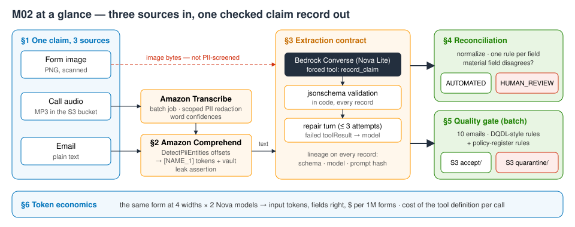
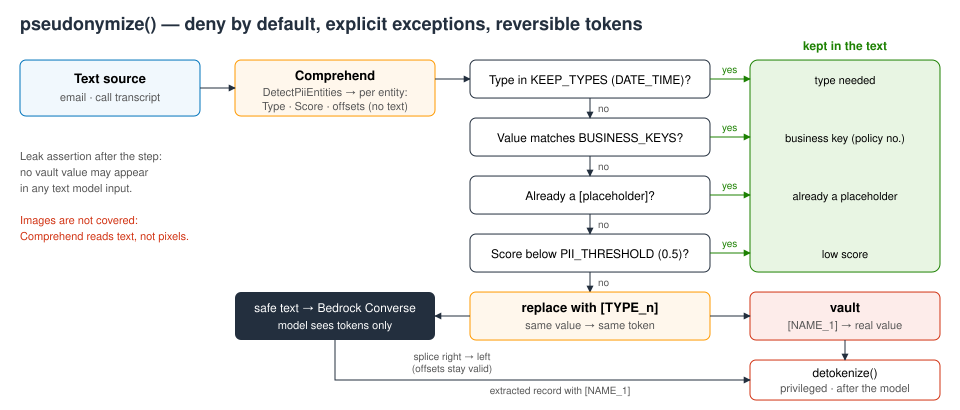
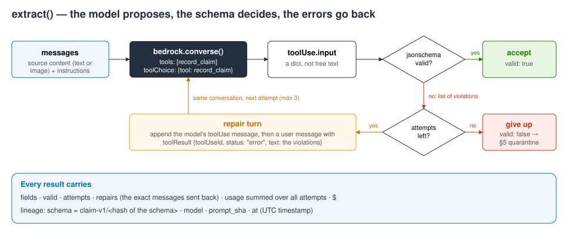

# M02 — Advanced Data Processing for Foundation Models · hands-on demo
**A multimodal ingestion pipeline with contracts**

**Accompanies:** course deck module 2 (Advanced Data Processing for Foundation Models), slides 7–27, with slides 31–33 for the token-economics section · **Services used:** Amazon S3, Amazon Transcribe (batch, PII redaction), Amazon Comprehend (PII detection), Amazon Bedrock (Converse with forced tool use; Nova Lite, Nova 2 Lite) · **Cost per run:** ≈ $0.03 (Transcribe with PII redaction ≈ 2 × 20 s of audio ≈ $0.02, ≈ 35 Nova calls ≈ $0.003, ≈ 15 Comprehend calls) · **Duration:** notebook ≈ 20 min, console ≈ 15 min · **Prep:** none beyond §0 (≈ 3 s: creates or adopts the S3 bucket and uploads the call recording)

> **How this guide was verified.** The notebook was run end to end, live, in us-east-1 in October 2026; every **Expect** below is a range measured over several of those runs. The console steps in Part 2 were checked through the equivalent API calls (the bucket and object, the Transcribe job settings and their transcripts, the Comprehend PII results for the texts below, the Nova token counts for the 1,000 px form with a plain JSON prompt), but the console pages, fields and buttons were **not** clicked through — labels may differ slightly from what you see. Model answers and detector scores vary from run to run, so treat every number as a range, not a target.

**Reading the notebook.** The lines worth studying carry a `# ▶ KEY` comment, and every section uses the same four boxes: 💡 **Concept** (the idea before the code), 🔑 **Key code** (where to look), 📊 **How to read this** (how to interpret the output) and ✅ **Takeaway** (the one sentence to keep). A **Summary** table at the end lists what you built.

## What you will learn
- How to turn a recorded phone call into text with an **Amazon Transcribe** batch job — and what PII redaction costs you: does the incident date survive "redact every type"?
- How to keep personal data from the **text** sources away from the model: Comprehend PII offsets → deny-by-default, **reversible pseudonymization** with a vault, explicit exceptions for your own business identifiers, and an assertion in code that no raw value reaches Bedrock. (The form *image* is not covered — you will see why in §3.)
- How to make extraction a **contract**: a JSON schema sent as a Converse **tool with forced `toolChoice`**, validated in code with `jsonschema`, a **repair turn** that returns the validation errors to the model, and lineage on every record.
- How to **reconcile** three sources field by field and send conflicts to a person, and how to run a **data-quality gate** with DQDL-style rules over a batch — failing records go to a quarantine with reasons, nothing is silently dropped.
- What images and structured output **cost in tokens**, per model and per resolution.



## Before you start
1. **Set up the environment** once, from the repository root (needs [uv](https://docs.astral.sh/uv/)):
   ```bash
   ./setup_env.sh
   .venv/bin/jupyter lab notebooks/
   ```
   Open [`../notebooks/M02_multimodal_contracts.ipynb`](../notebooks/M02_multimodal_contracts.ipynb) with the kernel **MLAIDP (Python 3.12)**.
2. **Credentials:** the notebook uses the standard AWS credential chain in **us-east-1**. If you use a named profile, set `AWS_PROFILE` before starting Jupyter. Your identity needs rights to create, read and delete an S3 bucket, to start, read and delete Transcribe jobs, to call `comprehend:DetectPiiEntities` and to invoke Bedrock models.
3. **Model access** (Bedrock → Model access, us-east-1): `us.amazon.nova-lite-v1:0` (the extractor in every section) and `us.amazon.nova-2-lite-v1:0` (§6 comparison). No step needs Anthropic Claude.
4. **Sound:** §1 plays the 20-second call. If you cannot play audio, read the transcript the notebook prints instead.
5. **Do not use Run All.** The last section is the cleanup; it deletes the bucket that Part 2 step 3 transcribes from.

§0 prints a banner with your account (shortened), the Region and a run id, then creates (or adopts, on a re-run) the bucket `mlaidp2-m02-<ACCOUNT>-us-east-1` — public access blocked, a 7-day lifecycle rule on `m02/` — and uploads `claim_call_AC-77812-H.mp3`. About 3 s.

## Part 1 — the notebook
In total the cells take about 30 seconds of compute; the slowest is the Transcribe cell (3–12 s).

### §1 One claim, three modalities · slides 20–22, 26–27, 12
**What the code does:** shows the claim Dana Ruiz filed three ways — a scanned form image, a phone call (plays inline) and an email. Then starts **two Transcribe jobs in parallel** on the same recording: one redacts every PII type, one only an explicit list (`PiiEntityTypes` = `MUST_REDACT`). Output goes to your own bucket (`OutputBucketName`), not to a pre-signed link. A diff cell compares the two transcripts word by word, and a confidence cell maps the words that carry each claim field to Transcribe's per-word confidence.

**What to look for:**
- The architecture is an ordinary landing bucket — private, with lifecycle expiry (keeping raw inputs only as long as needed is a privacy control) — feeding Transcribe for audio and Bedrock for image and text.
- "Redact everything" also removes the incident date — the one field the claim cannot do without. Redact what you must, and keep that list under version control.
- Confidence per *field*, not per transcript: a field whose evidence is weak goes to a person, whatever the model makes of it later.

**Key code to read:**
- In `ensure_bucket` (§0), the adopt-or-create check so a second run does not fail, and the lifecycle rule that expires raw inputs after 7 days — retention written as code.
- In `transcribe_call`, the redaction settings (the only difference between the two jobs is whether `PiiEntityTypes` is present), `OutputBucketName` (the transcript lands in your bucket) and the polling loop for an asynchronous job.
- The diff line that lists the words only the scoped job kept, and in the confidence cell the `min(...)`: a field is only as certain as its weakest word.

**Expect:** each job finishes in 3–12 s (queue time varies). Redact-all transcript: "On the [PII], a big branch came down…"; the scoped one keeps "On the 4th of March". Diff → `removed only by 'redact all': ['4th of March,']` and **"✓ the incident date survives in the scoped job, not in 'redact all'"**. Field confidences 0.97–0.99, all ✓; the lowest word in the call is `policy` at ≈ 0.965.

**If it goes wrong:** a job reports FAILED → the error text is printed; re-run the cell (the job is deleted and recreated). A slow queue (> 60 s) is not an error — just wait.

**Think about it:** Did "redact all PII" cost you a field the claim needs? Who in your organization decides which entity types are *must redact* — and where is that list versioned?
More questions in the notebook: should the *unredacted* transcript exist at all (`RedactionOutput`)? When would streaming transcription be the better choice than a batch job?

### §2 Personal data from the text sources never reaches the model · slides 11–12
**What the code does:**
1. A **probe**: three short inbox lines go through `detect_pii_entities` so you can see what the detector thinks your policy numbers are.
2. `pseudonymize()`: deny by default — every detected type above the threshold (0.5) is replaced by a placeholder such as `[NAME_1]`, except types the task needs (`KEEP_TYPES`, e.g. dates) and values that match your own identifier formats (`BUSINESS_KEYS`). Comprehend returns **offsets**, not strings, so the text is rebuilt from the offsets, right to left, so earlier offsets stay valid.
3. A **vault** keeps placeholder → real value; `detokenize()` is the privileged way back.
4. The (already redacted) call transcript goes through the same policy again, and a check asserts that no vault value appears in any text sent to Bedrock.



**What to look for:**
- The probe is the reason the exceptions exist: policy numbers come back as `LICENSE_PLATE` (and the word "Hail" as a `NAME`). Without the `BUSINESS_KEYS` allow-pattern, deny-by-default would erase the policy number — in an early version of this demo 4 of the 9 inbox emails that state one lost it.
- Pseudonymization is not masking: the model still sees that there *is* a name, an email and a phone number, and you can reverse it.
- Running the transcript through a second detector is defense in depth; Transcribe's own `[PII]` placeholders are recognized and left alone.
- Be precise about the guarantee: it covers the **text** sources. The form image goes to the model unredacted in §3.

**Key code to read:**
- In the probe, the slice `line[BeginOffset:EndOffset]`: Comprehend returns offsets, not the matched string.
- In `pseudonymize`, the chain that sets each entity's action — read it as the written policy: needed type, business key, already a placeholder, low score, otherwise replace. Then the token reuse (the same value always gets the same placeholder, so the model can still tell two people apart) and the splice loop that works from the end of the string.
- `detokenize` — the only way back to a real value, and only for code that holds the vault.
- The `leaks = [...]` check: a test in code that fails loudly, not a comment that promises safety.

**Expect:** probe — `hp 4410` → LICENSE_PLATE ≈ 0.82, `HP-2291` → LICENSE_PLATE ≈ 0.92, `AC-77812-H` → a national-ID-type label at ≈ 0.4 (DRIVER_ID ≈ 0.64 in another run); "Hail" → NAME ≈ 0.86–0.93. Labels and scores change between runs. The email: EMAIL, PHONE, ADDRESS, NAME replaced by `[EMAIL_1]`, `[PHONE_1]`, `[ADDRESS_1]`, `[NAME_1]`; three DATE_TIME entities kept. Then **"vaults hold 4 values; ✓ no raw PII value in any text model input"**.

**Think about it:** The vault makes redaction reversible. Where must the vault live in production — and who may call `detokenize`?
More questions in the notebook: masking, tokenization or removal — which keeps extraction quality, and which can be erased on request under GDPR? With a 0.5 threshold, how does the precision/recall trade-off differ between a support chatbot and a claims archive?

### §3 Extraction as a contract · slides 23–25, 9, 13
**What the code does:** defines the claim schema `claim-v1` — a canonical policy-number pattern, an ISO date, an enum for the `room` field, `UNKNOWN` sentinels instead of nullable fields — and shows `jsonschema` rejecting a plausible-looking bad record. `extract()` sends the schema to **Nova Lite** as a tool with forced `toolChoice`, validates the tool input in code, and on failure sends the errors back as a failed `toolResult` (at most three attempts). Each record carries lineage: schema id, model, prompt hash, timestamp. Three branches — form image, pseudonymized email, pseudonymized call — run in parallel.



**What to look for:**
- Nova does not accept a JSON schema through Converse's `outputConfig`; a tool with forced `toolChoice` gets the same result. The model's output is still untrusted — the validation happens in your code.
- The repair turn shows the model exactly what broke, which is usually enough.
- The schema design was tested against the model too: a version with nullable types and a null enum value made Nova 2 Lite return nonsense fields, which is why the schema uses sentinels.
- Wall clock vs sum of branches: in production this would be a Step Functions Parallel state, and the slowest branch sets the time.
- Look at the form row's `claimant`: the real name, read from the pixels. The text branches carry `[NAME_1]` / `[PII]`. Comprehend reads text, not images — protecting an image needs OCR with bounding boxes (Amazon Textract) and pixel redaction first, or Amazon Bedrock Data Automation.

**Key code to read:**
- `SCHEMA_ID` is a hash of the schema — the contract's version — and `TOOL` is built from the *same* schema object the validator uses, so model and validator can never drift apart.
- In `extract`, in order: the forced `toolChoice`, the token counter that includes every repair attempt, `violations(...)` on the tool input (the model's output is untrusted), and the repair turn that appends the model's message plus a failed `toolResult` naming what broke.
- In the branch definitions, the image content block: raw bytes, with no PII step on that path.

**Expect:** the bad-record example fails on five rules (missing `damaged_item`, `AC 77812H`, `03/03/2026`, `Kitchen`, `'1,180'`). Form: 1 attempt, 2,280 input tokens, claimant "Dana Ruiz", 2026-03-03, kitchen, 1180. Email and call usually need **one repair turn** each (the email omitted `room`; the call wrote `AC-77812H`) and end ✓ valid. The call extracts 2026-03-04, living room, 1100. Wall clock ≈ 1.8–2.1 s vs a sum of ≈ 5.2–6.2 s.

**If it goes wrong:** no repair turn this time → not a problem; the loop is there for the runs that need it, and the bad-record example shows what it catches.

**Think about it:** The schema says *what shape* a record has; nothing yet says *whether it is true*. Which of these fields could pass validation and still be wrong?
More questions in the notebook: why sentinels instead of optional fields — what does a model do with an optional field it cannot fill? When should a repair loop give up and route to a human rather than to a stronger model?

### §4 Reconciliation at the sync point · slides 21, 24
**What the code does:** normalizes each field (`AC 77812H` = `AC-77812-H`), compares the three sources with one rule per field (equal, same category, amounts within 10 %), and decides: a disagreement on a **material** field sends the claim to a person; other fields are resolved by source precedence (the signed form wins) and flagged. Low transcription confidence counts as a disagreement.

**What to look for:** the model would happily write an assessment from any one source — it has no idea the sources disagree. The decision and its reasons are logged so an auditor can see why the claim went to a person.

**Key code to read:** `norm` (compare canonical forms, not raw strings); the line that treats low transcription confidence from §1 as a disagreement; the precedence line that picks a value while keeping the conflict in the reasons list; and the single `route = ...` line — any material conflict goes to a person, the model never breaks the tie.

**Expect:** policy_number agree; **incident_date DISAGREE** (03 vs 04 March); **room DISAGREE** (kitchen vs living room); damaged_item agree (same category); amount agree (1180 vs 1100, within 10 %) → route **HUMAN_REVIEW** with both reasons, and **"✓ both planted conflicts caught"**.

**Think about it:** The signed form says 3 March, the call says 4 March. Should a model be allowed to pick one? What would you log so an auditor can see *why* the claim went to a person?
More questions in the notebook: how far apart are the three amounts, and who sets the 10 % tolerance? Which branch dominates the wall clock — and what does that say about where to optimize?

### §5 A data-quality gate with a quarantine · slides 7–10, 16
**What the code does:** shows a morning's inbox of ten claim emails and a small policy register, defines rules named the way you would write them in an **AWS Glue Data Quality** ruleset (completeness, referential integrity, uniqueness, value ranges) plus domain rules from the register (inside the policy period, not in the future, reported within 30 days, amount within the limit), runs `ingest()` (pseudonymize → extract under the contract) on all ten, applies the gate, and writes accepted and quarantined records — with failed rules and lineage — to S3.

**What to look for:**
- The email's sent date goes into the prompt so "two days ago" can resolve to a date; without it the model invents one.
- The quarantine is data, not a log line: a reviewer queue in S3. The quality score is the number you would alarm on (module 8).
- Rules run *after* extraction catch what the model cannot know — a lapsed policy, a resent claim.

**Key code to read:**
- The `RULES` list: the contract result from §3 is the first rule, then generic rules, then domain rules such as `ReferentialIntegrity` against the policy register.
- In `ingest`, the sent date passed into the prompt and the `MISSING` defaults that let the gate read every record.
- In the gate cell, the list of failed rules (every rule runs, every reason is kept) and the `put_object` to `accept/` or `quarantine/` with lineage — nothing is deleted.

**Expect:** 10 emails in ≈ 3.1–3.8 s for ≈ $0.0007–0.0008. ACCEPT: E01, E03 (`hp 4410` normalized to HP-4410), E09 (4 PII values replaced, including an SSN and an account number). QUARANTINE: E02 IsComplete policy_number, E04 WithinPolicyPeriod (lapsed), E05 NotInFuture, E06 ReportedWithin 30 days, E07 amount above the limit, E08 IsUnique (a resend of E01), E10 amount > 0 (a billing email). Quality score 92 %, **"✓ 10/10 decisions caught by the planted rule"**, 3 accept and 7 quarantine records in S3. E03's date may come out 2026-04-30 instead of 2026-04-29 ("two days before 1 May") and still pass — no rule checks relative dates.

**If it goes wrong:** one decision differs → the ✗ line names the email; open its row. It is usually the model's date for a relative phrase — which is exactly why rules run after extraction.

**Think about it:** E08 resends E01. Did the uniqueness rule catch it? What key defines "the same claim" — and what happens to that rule when the customer resends with a slightly different amount?
More questions in the notebook: which rules belong in Glue Data Quality and which in a Lambda validator? Which rules could run *before* the model and save the call?

### §6 Token economics of images — and of the contract · slides 23, 31–33
**What the code does:** sends the same form at four widths (2,000 / 1,000 / 500 / 250 px) to Nova Lite and Nova 2 Lite through the same contract, against known ground truth, and records input tokens, fields right and $ per million forms. Then measures the cost of the contract itself: the same image with a plain "return JSON" prompt vs the forced tool. A chart summarizes both.

**What to look for:**
- Image tokens are priced per model and are not linear in pixels: Nova Lite charges the same from 500 to 2,000 px and about half at 250 px (still 4/4 here); Nova 2 Lite charges the same at every width and loses a field at 250 px.
- The newer model is not the cheaper reader for this form.
- The tool definition is input tokens on every call — on Nova 2 Lite it costs more than the image.

**Key code to read:** in `form_at`, `extract(..., attempts=1)` — one attempt, so the tokens and the accuracy belong to exactly one call; in `input_tokens`, the line that adds `toolConfig` only for one arm — the two arms differ in nothing else, so the token difference *is* the price of the contract.

**Expect (identical across runs):** Nova Lite 2,280 tokens at 2,000 / 1,000 / 500 px and 1,217 at 250 px, 4/4 everywhere, ≈ $153 → $89 per million forms. Nova 2 Lite 1,452 tokens at every width, 4/4 except 3/4 at 250 px, ≈ $760 per million forms. Contract overhead: Nova Lite 1,570 → 2,266 input tokens (+696, ≈ $42 per million calls); Nova 2 Lite 299 → 1,437 (+1,138, ≈ $376 per million calls).

**Think about it:** Does each model charge less for a smaller image — and does it still read every field? What rule would you write into your preprocessing step: a fixed width, or one measured per model?
More questions in the notebook: when is the contract's ≈ 700–1,100 extra input tokens worth it, and when is "return JSON" plus validation enough? Crop or downscale — which keeps small handwriting readable?

## Going deeper
- **Transcribe PII redaction settings.** Batch redaction (`ContentRedaction`) supports a set of English and Spanish variants. `RedactionOutput` is either `redacted` (only the redacted transcript is written) or `redacted_and_unredacted` (both — and then the unredacted file is the one to protect). Leaving out `PiiEntityTypes` means every type, including ones such as CREDIT_DEBIT_EXPIRY and BANK_ROUTING; in every run here that setting also removed the spoken incident date. Measure what a setting removes rather than guessing from the type names. Live calls use streaming transcription, which has its own PII identification and redaction.
- **Three Comprehend PII APIs.** `DetectPiiEntities` is synchronous (up to 100 KB of UTF-8) and returns offsets and scores; `ContainsPiiEntities` returns only types and scores — a cheap yes/no gate; `StartPiiEntitiesDetectionJob` processes documents in S3 asynchronously and can write a redacted copy. The detector labels by appearance, so short alphanumeric identifiers often look like plates or ID numbers — an allow-list for your own formats is normal.
- **Where the vault belongs.** In production: a DynamoDB table (or Secrets Manager for a handful of values) encrypted with a customer managed KMS key, a detokenize Lambda that only the post-processing role may invoke, and a log entry for every call. Deleting a person's vault entries makes their pseudonymized records unlinkable — handy for erasure requests, provided no detokenized copy (like this notebook's S3 records) exists elsewhere.
- **Forced tool use versus `outputConfig`.** Converse also offers structured output through `outputConfig` for models that support it (gpt-oss accepted it during testing; Nova rejects it). A forced `toolChoice` works on more models and returns a parsed object. Neither guarantees the values are *correct*, which is why `jsonschema` and the gate rules follow.
- **Glue Data Quality as the managed gate.** DQDL rulesets run inside Glue ETL jobs (the `EvaluateDataQuality` transform) or against Data Catalog tables. Results carry a score and per-rule outcomes, can be published to CloudWatch and EventBridge, and rows can be split into passed and failed outputs — the managed equivalent of this notebook's quarantine.
- **Why image tokens must be measured.** Each model resizes an image to its own input size before tokenizing, so the bill depends on that model's preprocessing. The notebook therefore reads `usage.inputTokens` instead of estimating tokens from pixel counts.

## Questions to check your understanding
1. Why not ask the model to redact the PII itself?
   <details><summary>Answer</summary>By then the raw values have already been sent to the model, and its "redaction" is text you cannot verify. Detecting entities with offsets before the call, and checking the result in code, is auditable.</details>
2. Why build these steps by hand instead of using Amazon Bedrock Data Automation?
   <details><summary>Answer</summary>BDA is the managed option for documents, images and audio at volume (blueprints, confidence scores, bounding boxes). Writing the steps here makes each control and its failure mode visible — and the contract, reconciliation and gate still apply on top of BDA output.</details>
3. Can the repair loop make a record worse?
   <details><summary>Answer</summary>Yes — a repair can change a field that was already right. That is why the whole record is validated again on every attempt, and why attempts are capped and recorded.</details>
4. The form and the call agree on a value, but both are wrong. Does reconciliation catch it?
   <details><summary>Answer</summary>No. Reconciliation detects disagreement, not truth. The domain rules (policy period, limits) and a sampled human audit are the backstop.</details>

## Part 2 — the same in the console
The same claim without code. Steps 3–4 transcribe the recording from the notebook's bucket, so **run every cell above Cleanup first; don't use Run All** (≈ 35 s). Have [`../assets/claim_form_1000px.png`](../assets/claim_form_1000px.png) and [`../assets/claim_form_250px.png`](../assets/claim_form_250px.png) ready to upload. Region: us-east-1.

1. **Comprehend, real-time PII.** Amazon Comprehend → **Real-time analysis** → **Built-in** → paste the email the notebook prints in §1 → **Analyze** → tab **PII**.
   **Expect (API-verified):** EMAIL, PHONE, ADDRESS and NAME with scores ≈ 1.0, and three DATE_TIME entities — with begin/end offsets, the same response §2 rebuilds the text from.
2. **The business-key trap.** Clear the box, paste `HP-2291 here. The storm on 12 November 2026 broke our bedroom window.` → **Analyze**.
   **Expect (API-verified):** `HP-2291` detected as LICENSE_PLATE ≈ 0.9. A redactor that denies by default would erase your policy number; your policy needs an allow-pattern for your own identifiers.
3. **Transcribe with scoped redaction.** Amazon Transcribe → **Batch transcription** → **Create job**: name `mlaidp2-m02-console-call`, *Specific language* English, US; input `s3://mlaidp2-m02-<ACCOUNT>-us-east-1/m02/input/claim_call_AC-77812-H.mp3`; output *Service-managed S3 bucket* → **Next** → *Content removal* → turn on **PII redaction** → choose only Name, Phone, Email, SSN, Address, Credit/debit card number and Bank account number (not all types) → **Create job**.
   **Expect (API-verified with the notebook's identical job):** COMPLETED in ≈ 3–30 s; transcript preview "Hi, my name is [PII] … On the 4th of March … My phone number is [PII]". Batch suits recorded files; live calls would use streaming transcription.
4. *(optional)* Repeat step 3 as `mlaidp2-m02-console-call-all` with **all** PII types.
   **Expect (API-verified):** "On the [PII], a big branch…" — the date is gone.
5. **Playground, the form image.** Amazon Bedrock → **Playgrounds** → **Chat** → model **Nova Lite** → attach `claim_form_1000px.png` → prompt `Return only JSON with policy_number, incident_date, damaged_item, room, amount_usd, claimant.` → **Run**, then open the response metrics.
   **Expect:** policy AC-77812-H, 2026-03-03, kitchen, 1180 (often wrapped in ``` fences); ≈ 1,570 input tokens (API-verified for this prompt; the playground may add a few tokens of its own). The playground cannot force a tool, so this is the "plain JSON" arm of §6: no contract, no validation.
6. **Resolution and model.** Same prompt with `claim_form_250px.png` → **Expect:** ≈ 520–540 input tokens (derived from the notebook's numbers, not measured in the console). Then switch the model to **Nova 2 Lite** with the 1,000 px file → **Expect (API-verified):** ≈ 300 input tokens. Image cost depends on the model and is not linear in pixels.

## Clean up
- Run the notebook's **Cleanup** section (after Part 2). It deletes every Transcribe job whose name contains `mlaidp2-m02` — including the console jobs from steps 3–4 — and empties and deletes the bucket, then prints **"✓ nothing left"**.
- Nothing to undo in Comprehend or the playground.
- To double-check the account: `.venv/bin/python tools/sweep.py` lists anything named `mlaidp2` that is still there (see [`../tools/sweep.py`](../tools/sweep.py)).
- Cost per run ≈ **$0.03**: Transcribe with PII redaction on ≈ 2 × 20 s of audio (≈ $0.02; four jobs if you do steps 3–4), ≈ 35 short Nova calls (≈ $0.003) and ≈ 15 Comprehend calls. The bucket's lifecycle rule expires anything you forget under `m02/` after 7 days.
