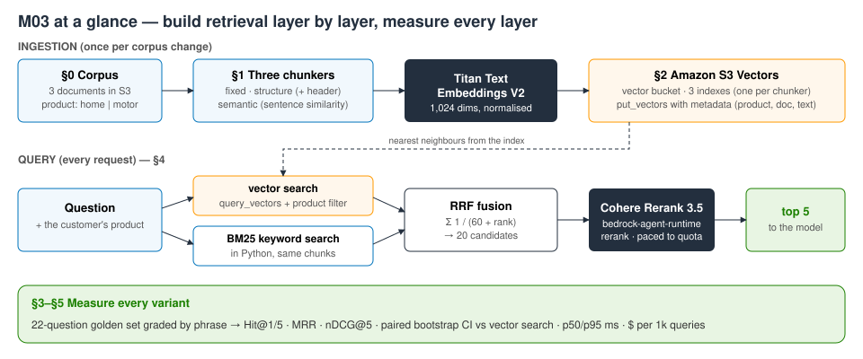
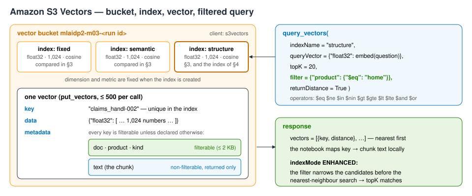
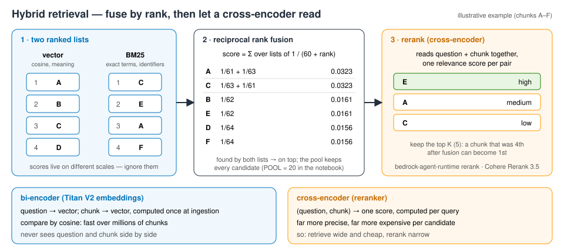

# M03 — Vector Databases and Retrieval Augmentation — demo
**Build retrieval yourself, then measure it**

**Accompanies:** course deck module 3 (Vector Databases and Retrieval Augmentation), slides 6–45, with slides 50 and 59 for the cost section · **Services used:** Amazon Bedrock (Titan Text Embeddings V2, Cohere Rerank 3.5; in the console also Knowledge Bases and Nova Pro), Amazon S3 Vectors, Amazon S3 · **Cost per run:** ≈ $0.05 (23 rerank calls × $0.002; embeddings and S3 Vectors < $0.001) · **Duration:** notebook ≈ 20 min, console ≈ 15 min · **Prep:** §0 + §0 Prep (≈ 10 s: uploads the three documents); the S3 Vectors bucket is created in the first cell of §2

> **How this guide was verified.** The notebook was run end to end, live, in us-east-1 in October 2026; every **Expect** below is a range measured over several of those runs (the retrieval scores were identical in every run). The console steps in Part 2 were checked through the equivalent API calls (a Knowledge Base on the same documents, S3 Vectors storage, Titan V2, default chunking — ingestion, filter, reranking and query decomposition behave as described), but the console pages, fields and buttons — including the quick-create flow — were **not** clicked through, so labels may differ slightly from what you see. Generated answers vary from run to run.

**Reading the notebook.** The lines worth studying carry a `# ▶ KEY` comment, and every section uses the same four boxes: 💡 **Concept** (the idea before the code), 🔑 **Key code** (where to look), 📊 **How to read this** (how to interpret the output) and ✅ **Takeaway** (the one sentence to keep). A **Summary** table at the end lists what you built.

## What you will learn
- How three **chunkers** — fixed-size with overlap, structure-aware with a contextual header, and semantic breakpoints on embedding similarity — decide whether a fact survives in one piece.
- How to use **Amazon S3 Vectors** through the API: vector bucket, index (dimension and distance metric fixed at creation), `put_vectors` with metadata, `query_vectors` with a **metadata filter** — and what an unfiltered query drags in from the wrong product.
- How to build **hybrid retrieval** in code: BM25 written in Python plus vector search, fused with **reciprocal rank fusion** (RRF), then reranked with **Cohere Rerank 3.5**.
- How to score every layer on a 22-question golden set with **Hit@k, MRR and nDCG@5**, a **paired bootstrap** interval on the improvement, and latency and dollars per query — and how a small rerank quota shapes the design.



## Before you start
1. **Set up the environment** once, from the repository root (needs [uv](https://docs.astral.sh/uv/)):
   ```bash
   ./setup_env.sh
   .venv/bin/jupyter lab notebooks/
   ```
   Open [`../notebooks/M03_build_and_measure_retrieval.ipynb`](../notebooks/M03_build_and_measure_retrieval.ipynb) with the kernel **MLAIDP (Python 3.12)**.
2. **Credentials:** the notebook uses the standard AWS credential chain in **us-east-1**. If you use a named profile, set `AWS_PROFILE` before starting Jupyter. Your identity needs Bedrock invoke and rerank rights, S3 and S3 Vectors create / write / query / delete rights, and for Part 2 the right to create a Knowledge Base and an IAM service role.
3. **Model access** (Bedrock → Model access, us-east-1): `amazon.titan-embed-text-v2:0` and `cohere.rerank-v3-5:0`; for Part 2 also `us.amazon.nova-pro-v1:0`. No step needs Anthropic Claude.
4. **Quotas:** Cohere Rerank 3.5 has its own on-demand quota (requests per minute, in Service Quotas). In the test account it was **25 requests per minute**, so the notebook reads the quota and **paces its rerank calls** to stay just under it — the §4 cell takes about a minute because of that pacing, not because the service is slow. Don't run the notebook twice within a minute, and expect a slower cell if something else in your account is using rerank at the same time.
5. **Do not use Run All.** The last cells are the cleanup, and Part 2 reads the documents bucket the notebook creates.

§0 prints a banner with your account (shortened), the Region and a run id; §0 Prep uploads the documents to `s3://mlaidp2-m03-docs-<run id>/docs/`. The corpus is in [`../assets/m03_docs/`](../assets/m03_docs/) plus [`../assets/m03_motor_policy_wording_MP-2026.txt`](../assets/m03_motor_policy_wording_MP-2026.txt).

## Part 1 — the notebook
In total the cells take about 1.5 minutes of compute; one minute of that is the paced rerank cell in §4.

### §0 Prep — the corpus · slides 6–8
**What the code does:** uploads three documents for the AnyCompany Insurance support desk — the home policy wording and the agents' claims manual (product `home`) and a motor policy wording (product `motor`) — each with a `.metadata.json` sidecar, the format a Bedrock Knowledge Base reads in Part 2. The notebook itself works on the local copies.

**What to look for:** the motor wording is a deliberate confuser. It talks about deductibles, glass, theft and flood — the same words as the home wording, with different numbers. Real policy libraries look like this.

**Key code to read:** the second `put_object` — a `<document>.metadata.json` file stored next to each document, which a Knowledge Base turns into filterable attributes.

**Expect:** three rows: home policy ≈ 6,000 characters, claims manual ≈ 2,200, motor policy ≈ 3,600.

### §1 Three chunkers · slides 21–26
**What the code does:** cuts the corpus three ways. *Fixed-size*: 60 words with a 10-word overlap. *Structure-aware*: split at headings and paragraphs, merge short paragraphs, prefix every chunk with a contextual header (document › section). *Semantic*: split into sentences, embed each sentence with Titan V2 (`InvokeModel`, normalised, so the dot product is the cosine similarity), and cut where neighbour similarity falls into its lowest 20 %. A table then checks whether two facts stay whole: claim status R7 together with its handling rule, and a table row together with its header.

**What to look for:**
- The overlap in the fixed chunker is what rescues a fact that straddles a boundary — paid for with duplicated text.
- The structure chunk carries its origin in its first line (`… › Status codes in the claims system`), so "Section 4 – Deductibles" can match a question about a deductible.
- Semantic chunking is about 15 lines of code, but it costs one embedding per sentence at every re-ingestion.

**Key code to read:**
- In `fixed_chunks`, the step `size - overlap`: neighbouring chunks share `overlap` words.
- In `structure_chunks`, the line that writes the contextual header `[document › section]` into each new chunk.
- In `embed`, the Titan V2 request body (`dimensions` and `normalize`) and the token counter read from the response, metered per stage.
- In `semantic_chunks`, the percentile cut-off; and `keeps_together`, which asks whether *one* chunk holds every phrase of a fact — the check behind the ✓/✗ columns.

**Expect (deterministic):** fixed 42 chunks (mean ≈ 324 characters), structure 43 (mean ≈ 342, max ≈ 830), semantic 37 (mean ≈ 316). R7 + its rule in one chunk: fixed ✓, structure ✓, **semantic ✗** (it splits the status-code list). Semantic chunking used 2,724 embedding tokens.

**Think about it:** The fixed chunker is the default in many tutorials. Which kinds of documents in *your* organisation would it damage most — and how would you notice before a customer does?
More questions in the notebook: the contextual header costs tokens in every chunk — when is it worth it? When does re-ingestion make semantic chunking expensive?

### §2 Amazon S3 Vectors through the API · slides 11, 28, 31–32
**What the code does:** creates the vector bucket `mlaidp2-m03-<run id>` and one index per chunker (1,024 dimensions, cosine), with the chunk `text` declared **non-filterable** metadata; embeds every chunk and loads it with `put_vectors`; then runs the same home-insurance question with and without the filter `product = home`.



**What to look for:**
- The printed index JSON: dimension and distance metric are fixed for the life of the index. Text is returned with the results but never filtered on — the filterable part of a vector's metadata is limited to 2 KB.
- `indexMode: ENHANCED`: indexes created after 30 September 2026 apply the filter *before* the nearest-neighbour search, so a selective filter still returns the full `topK`. Older (CLASSIC) indexes filter during the search and can return fewer results.
- Loading is idempotent by key, and keys that are no longer in the chunker's output are deleted — an index must never serve a chunk that no longer exists.
- Unfiltered, the motor deductibles chunk lands at position 2 for a home question. The customer's product is known before the search starts, so filter on it.

**Key code to read:**
- `INDEX_CONFIG`: dimension and distance metric fixed at creation and matched to the embedding model; `text` listed as non-filterable.
- `create_vector_bucket` on its own `s3vectors` client — a vector bucket is a separate resource type, not a general purpose S3 bucket — and one index per chunker.
- In `load_index`, the record shape (key + vector + metadata; the same key overwrites on a re-run) and the deletion of stale keys.
- In `vector_search`, the one-line `filter` that makes only the customer's product eligible.

**Expect:** 42 / 43 / 37 vectors, ≈ 3–5 s per index, 0 stale deleted; 11,833 embedding tokens ≈ $0.0002 for the whole corpus, three times. One query: embedding ≈ 130–290 ms + `query_vectors` ≈ 150–270 ms. Unfiltered top 3 contains one `[motor]` chunk; filtered top 3 is all `[home]`.

**If it goes wrong:** `ConflictException` on create → the bucket from an earlier run is still being deleted; wait 30 s and run the cell again.

**Think about it:** Without the filter, the motor deductibles compete with the home ones for "a window breaks". What else besides the product would you put in the metadata of a real policy library — and who sets it?
More questions in the notebook: which filter keeps the internal claims manual out of a customer-facing chatbot, and is a filter enough? What happens when a policy version is superseded (slide 28)?

### §3 A golden set and three metrics · slides 17, 45, 50
**What the code does:** defines 22 questions (4 about the motor product), each with the phrases that must appear together in one chunk of the right product. A chunk is graded 2 if it holds every phrase and 1 if it holds some. `score` computes Hit@1, Hit@5, MRR, nDCG@5 and recall@20 (a worked example is printed). Then it checks how many answers each chunker keeps whole, runs 132 searches (22 questions × 3 chunkers × with/without filter) and shows the top chunk each chunker returns for **Q01**, the R7 question.

**What to look for:**
- Grading by phrase rather than chunk id is what lets one answer key judge three different chunkers. nDCG uses the grades; Hit and MRR count only grade 2.
- "Kept whole" is the ceiling: everything later only reorders chunks, it cannot repair a split fact.
- The fixed chunker kept R7 whole and still lost Q01: its top chunk is the R1–R4 part of the list. Small chunks can dilute ranking even when nothing is split.
- The wrong-product column: every motor chunk in a home answer's top 5 is tokens you pay for and a contradiction you hand to the model.

**Key code to read:** in `grade`, the product check that comes first (a wrong-product chunk scores 0 whatever its text says) and the 2/1/0 grades; in `score`, the DCG line — sum of (2^grade − 1) / log2(rank + 1), divided by the DCG of the ideal order — which you can follow on the printed worked example; in `evaluate`, the count of wrong-product chunks in the top K that becomes the last column of the chunker table.

**Expect (identical in every run):** kept whole — fixed 22/22, structure 22/22, semantic 21/22 (misses Q01). MRR with the filter: fixed 0.67, **structure 0.80**, semantic 0.70; Hit@5 0.86 / 0.91 / 0.82. Wrong-product chunks in the top 5 without the filter: fixed 19, structure 14, semantic 17 (0 with it). Q01 top chunk: fixed grade 0, structure grade 2, semantic grade 0.

**Think about it:** Suppose one chunker wins on this corpus. Would you ship that choice for a corpus of 10,000 scanned PDFs? What would you have to measure first?
More questions in the notebook: what does the wrong-product count cost you in tokens and in wrong answers? How many questions would you need before a 0.05 difference in MRR means something?

### §4 Hybrid retrieval and reranking · slides 12, 45
**What the code does:** implements BM25 in about 20 lines over the structure-aware chunks, with a tokenizer that keeps identifiers such as `r7`, `bil-dup` and `7.3.2` whole; fuses BM25 and vector results with **RRF** (1/(60 + rank) summed over lists — no score normalisation needed); calls **Cohere Rerank 3.5** through `bedrock-agent-runtime.rerank`; reads the rerank quota from Service Quotas and paces calls to it. One cell then runs four variants for every question — vector (filtered), BM25, hybrid RRF, and hybrid + rerank on the 20-candidate pool — with latency per layer. A scoreboard, a **paired bootstrap** on ΔMRR against vector search, a chart and a "moved questions" table follow.



**What to look for:**
- Exact identifiers are where embeddings blur and BM25 is precise (the `clause 7.3.2` lookup). The reverse also happens: BM25 misses vocabulary mismatches such as "diamond ring" vs "jewelry", where vectors win.
- RRF acts mainly as a **candidate generator** here: the pool recall@20 reaches 1.00, but the ranking at the top barely changes.
- The reranker is a cross-encoder: it reads the question and each candidate together. For Q16 (newborn baby, flooded kitchen) it lifts the chunk vector search ranked 17th to first.
- The bootstrap resamples questions. Only an interval that excludes 0 counts as a result — two "not distinguishable" lines are the intended finding, not a failure.
- A client that knows its quota queues its requests instead of collecting `ThrottlingException`s, and reports the queueing separately from service latency.

**Key code to read:**
- The `tokenize` regex that keeps identifiers such as `7.3.2` and `bil-dup` as single tokens, and the BM25 scoring line: idf × saturated term frequency, normalised by chunk length.
- In `rrf`, `fused[key] += 1 / (k + rank + 1)` — the whole algorithm; only ranks count.
- The Service Quotas read and `RateLimiter.wait`, which reserves the next slot while holding the lock and sleeps after releasing it.
- In `rerank`, the request (one query, the candidate texts inline, the model by ARN) and the result `index` that points back into the candidate list, best first.
- In `run_question`, the layer stack: each variant is a prefix of the same retrieval, which is what makes the bootstrap comparison *paired*; and in `paired_bootstrap`, resampling questions (not chunks) with replacement.

**Expect:**
- Quota printed as 25 requests per minute (yours may differ); the four-variant cell takes ≈ 57–61 s. Rerank latency p50 ≈ 205–240 ms, p95 ≈ 225–1,900 ms (higher when others use rerank in the account).
- Scoreboard (identical in every run): vector MRR 0.80 / nDCG@5 0.82, misses Q05 Q16; BM25 0.83 / 0.84, misses Q08 Q19; hybrid RRF 0.83 / 0.85, misses Q16; **hybrid + rerank 0.93 / 0.95, no misses, Hit@1 0.86**. Latency p50: vector ≈ 300–335 ms, hybrid + rerank ≈ 515–570 ms. $ per 1k queries: vector ≈ $0.003, hybrid + rerank ≈ $2.00.
- Bootstrap ΔMRR vs vector: BM25 +0.03 [−0.12, +0.19] and RRF +0.03 [−0.08, +0.14] → "– not distinguishable on 22 questions"; **hybrid + rerank +0.14 [+0.04, +0.25] ✓ better**.
- Moved questions: 8 of 22; for Q16 the reranked top 3 came from vector ranks [17, 3, 1].

**If it goes wrong:** the cell takes much longer than a minute → something else in your account is using rerank (adaptive retries kick in); the results are still valid. `AccessDeniedException` on rerank → model access for Cohere Rerank 3.5 is missing.

**Think about it:** At list price a rerank call costs about 700× a vector query, and its on-demand quota is a few hundred times smaller. Where would you spend it only *some* of the time — and on which signal would you decide?
More questions in the notebook: did BM25 lose a question that vector search found, and which word explains it? Pool recall caps what any reranker can do — how would you raise it without raising latency?

### §5 What a layer costs at scale · slides 50, 59
**What the code does:** projects the measured per-query cost of each variant to 1 million queries a month, next to its MRR and p50 latency. Embedding the corpus is a one-off; the queries are the bill.

**Key code to read:** the per-query price lines in §4 — the rerank line carries almost the entire cost — and how this table multiplies them by the monthly volume.

**Expect:** vector $3, BM25 $0, hybrid RRF $3, **hybrid + rerank ≈ $2,003** per month; one-off ingestion ≈ $0.0002.

**Think about it:** 1 million queries a month is about 23 a minute on average — compare that with the rerank quota printed in §4. What do you ask for first: a quota increase, a cache, or a gate that reranks only the hard questions?

## Going deeper
- **Choosing a vector store.** S3 Vectors has no cluster or capacity to size and charges for storage, data written and queries — the cheapest home for large vector sets that are queried occasionally, at query latencies of a few hundred milliseconds. OpenSearch offers lower latency, higher throughput and built-in hybrid (keyword + vector) search; Aurora PostgreSQL with pgvector keeps vectors beside relational data. A common pattern keeps everything in S3 Vectors and exports a hot subset to OpenSearch.
- **Index limits.** Dimension, distance metric and the non-filterable keys are fixed by `CreateIndex`. Filterable metadata is capped at 2 KB per vector (total metadata may be larger, so put long text in non-filterable keys), and one `PutVectors` call accepts up to 500 vectors. Switching embedding model or dimension means a new index and re-embedding everything.
- **Titan V2 dimensions.** You can request 1,024, 512 or 256. Smaller vectors cut storage and search cost roughly in proportion and lose a little retrieval quality — measure on your golden set before you shrink. With `normalize: true`, the dot product equals cosine similarity.
- **Where RRF's k = 60 comes from.** Cormack, Clarke and Büttcher (2009) found that a constant around 60 dampens the weight of the very top ranks just enough to work across many systems. It is a robust default that is rarely tuned.
- **Why a bootstrap and not a t-test.** Per-question MRR is far from normally distributed (mostly 1, 0.5 or 0). The bootstrap assumes no distribution, and resampling *paired* differences removes question difficulty from the comparison. With 22 questions the interval stays wide; resolving differences of a few hundredths takes a few hundred questions.
- **Reranking inside a Knowledge Base.** The same rerank model can be enabled in `Retrieve` / `RetrieveAndGenerate` through `rerankingConfiguration`. The Knowledge Base service role then needs `bedrock:Rerank` and `bedrock:InvokeModel` on the rerank model — Part 2 step 5 shows the error you get without them.

## Questions to check your understanding
1. Why build retrieval by hand when a Knowledge Base does it for you?
   <details><summary>Answer</summary>Part 2 uses one. Knowing what happens inside lets you evaluate its chunking options and filters on your own golden set instead of trusting the defaults.</details>
2. Should every query be reranked?
   <details><summary>Answer</summary>Only where the quality gain pays for the price, the added latency and the small quota. Gate it — for example when the top vector score is low, the question contains identifiers or several parts, or the stakes are high.</details>
3. Why did BM25 score about as well as vector search here?
   <details><summary>Answer</summary>A small corpus, precise wording and identifiers in the questions favour keyword search. On paraphrased questions or larger corpora vectors usually pull ahead — and the bootstrap shows that 22 questions cannot separate the two anyway.</details>
4. Where do golden-set questions come from in a real project?
   <details><summary>Answer</summary>From search logs and support tickets, labelled by subject-matter experts with the passage that answers each one. Add a question every time a retrieval failure reaches a customer.</details>

## Part 2 — the same in the console
A managed Knowledge Base on the same documents: the console does the chunking, embedding and S3 Vectors plumbing you wrote by hand in Part 1, and its test pane exposes the filter, reranking and query decomposition. You need the documents bucket from the notebook: **run §0 and §0 Prep (or every cell above Cleanup); don't use Run All**, and don't run the cleanup until you have finished Part 2. Region: us-east-1. Creating the Knowledge Base (steps 1–3) takes about 3 minutes.

1. **Create.** Amazon Bedrock → **Knowledge Bases** → **Create** → **Knowledge Base with vector store**. Name `mlaidp2-m03-console-kb`; IAM: **Create and use a new service role**; data source **Amazon S3**.
   **Expect:** the next page asks for the data source. Everything Part 1 wrote by hand — role, chunker, embedding calls, index — becomes a form.
2. **Data source.** S3 URI `s3://mlaidp2-m03-docs-<run id>/docs/` (the run id is in the notebook's §0 banner); *Parsing*: default; *Chunking*: open the list (Default, Fixed-size, Hierarchical, Semantic, No chunking, custom Lambda) and keep **Default** (fixed size, ≈ 300 tokens).
   **Expect:** no metadata configuration is needed — the `.metadata.json` sidecars become filterable attributes automatically (API-verified: 3 metadata documents scanned). The chunking options are the same ideas as §1, without the code.
3. **Embeddings and store.** **Titan Text Embeddings V2**; *Vector store*: **Quick create a new vector store** → **Amazon S3 Vectors** → **Create Knowledge Base**. When it is ready, open the data source → **Sync**.
   **Expect (API-verified):** the Knowledge Base becomes ACTIVE within seconds and the sync takes ≈ 10 s: 3 documents scanned, 3 indexed, 0 failed. Quick create itself (vector bucket and role) adds a minute or two. It makes an S3 vector bucket and index for you — the API calls of §2; its name prefix `bedrock-knowledge-base-…` is not verified.
4. **Metadata filter.** **Test knowledge base** → **Retrieval only** (generation off) → ask *Water came in from the river next to our house. Am I covered?* and look at the source chunks. Then **Configurations → Filters** → `product` *equals* `home` → run again.
   **Expect (API-verified):** unfiltered, the home flood exclusion comes first but a motor chunk ("flood is covered for vehicles…") appears at rank 3 — a wrong answer waiting to happen; filtered, all chunks are home and the motor chunk is gone.
5. **Reranking.** Still in the test pane: **Configurations → Reranking** → Cohere Rerank 3.5, number of results 5 (raise the number of source chunks to about 15); ask *My claim shows status R7. What do I tell the customer?*
   **Expect (API-verified):** the first chunk is the claims manual's status-code section with a relevance score ≈ 0.84; the next ones score ≤ 0.25. Retrieve wide, rerank narrow — and note that the reranker's score is not a cosine distance.
   **If it goes wrong:** `AccessDeniedException … bedrock:Rerank` → the console-created service role (`AmazonBedrockExecutionRoleForKnowledgeBase_…`) lacks rerank rights. IAM → that role → **Add permissions** → inline policy allowing `bedrock:Rerank` (Resource `*`) and `bedrock:InvokeModel` on `arn:aws:bedrock:us-east-1::foundation-model/cohere.rerank-v3-5:0`; wait about 30 s and try again.
6. **Query decomposition and citations.** Turn generation on with **Nova Pro**, keep the `product = home` filter, and ask: *Our basement flooded from the river and, the same night, a pipe burst in the kitchen. The carpet is ruined and we can't sleep there. What is covered, which deductible applies, and can we throw the carpet away?* Run it, then turn on query decomposition — probably **Configurations → Query modifications → Break down queries** (older consoles: *Query decomposition*; label not click-tested) — run again and open the citations.
   **Expect (API-verified, one run each):** ≈ 1.9 s without, ≈ 3.4 s with decomposition (an extra model call). Both answers said the river flood is not covered without the add-on, the burst pipe is covered, and the deductible is 750 USD; with decomposition the carpet answer was the precise one (keep it until the adjuster has seen it; you may move it outside). One embedding for a four-part question retrieves whatever is closest on average; decomposition retrieves per sub-question. Answers vary between runs — judge by the citations, not the prose.
7. **Close the loop.** S3 → **Vector buckets**: the quick-created bucket sits next to the notebook's `mlaidp2-m03-<run id>`.
   **Expect:** the same kind of store. The difference is who owns the chunker, the filter and the evaluation — and Part 1's golden set is how you would pick the console's chunking option.

## Clean up
- Run the notebook's **Cleanup** section **after Part 2**. It deletes the three vector indexes, the vector bucket `mlaidp2-m03-<run id>` and the documents bucket, and prints **"✓ nothing left"**. It is safe to run twice; after a kernel restart run §0 first (the run id comes from there).
- Delete the console resources by hand: the Knowledge Base `mlaidp2-m03-console-kb` (this deletes its data source); the quick-created S3 vector bucket (S3 → Vector buckets, name starting with `bedrock-knowledge-base-`; delete its index first); and the service role (IAM → Roles, `AmazonBedrockExecutionRoleForKnowledgeBase_…`).
- To double-check the account: `.venv/bin/python tools/sweep.py` lists anything named `mlaidp2` that is still there (see [`../tools/sweep.py`](../tools/sweep.py)). It finds the Knowledge Base by its name, but not the quick-created vector bucket or the service role, whose names do not contain `mlaidp2`.
- Cost per run ≈ **$0.05**, almost all of it the 23 rerank calls at $0.002 each; embeddings and S3 Vectors storage and queries stay below $0.001.
