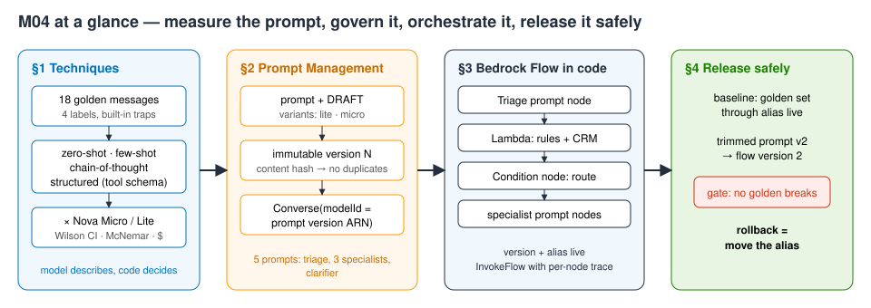
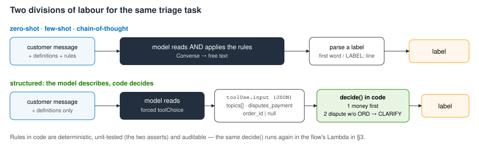
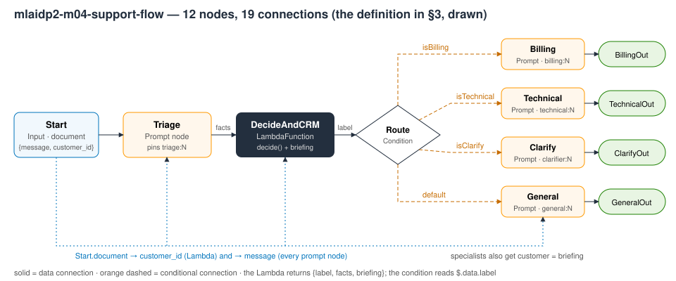
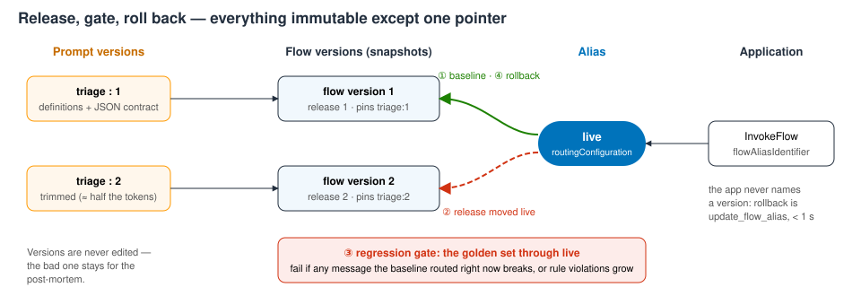

# M04 — Prompt Engineering and Governance · hands-on demo
**Prompts as governed, tested software**

**Accompanies:** course deck module 4 (Prompt Engineering and Governance), slides 11–42 (§1 alone fits after slide 21) · **Services used:** Amazon Bedrock (Converse; Nova Micro, Nova Lite), Amazon Bedrock Prompt Management, Amazon Bedrock Flows, AWS Lambda, AWS IAM, Amazon CloudWatch Logs · **Cost per run:** < $0.01 · **Duration:** notebook ≈ 20 min, console ≈ 15 min · **Prep:** §0 Setup + §0 Prep (≈ 20 s on a fresh account, ≈ 1 s when the two IAM roles already exist)

> **How this guide was verified.** The notebook was run end to end, live, in us-east-1 in October 2026; every **Expect** below is a range measured over several of those runs. The console steps in Part 2 were checked through the equivalent API calls (prompts, versions and variants, the flow and its versions, the alias, the draft's behaviour through the built-in test alias), but the console pages, fields and buttons were **not** clicked through — labels may differ slightly from what you see. Model answers vary from run to run, so treat every number as a range, not a target.

**Reading the notebook.** The lines worth studying carry a `# ▶ KEY` comment, and every section uses the same four boxes: 💡 **Concept** (the idea before the code), 🔑 **Key code** (where to look), 📊 **How to read this** (how to interpret the output) and ✅ **Takeaway** (the one sentence to keep). A **Summary** table at the end lists what you built.

## What you will learn
- How to compare four prompt techniques — **zero-shot, few-shot, chain-of-thought and structured output through a forced tool schema** — on a golden set, with Wilson intervals, tokens and dollars per 1,000 requests, and why the "best" technique depends on the model.
- How to treat a prompt as a resource in **Amazon Bedrock Prompt Management**: variants (one per model), immutable numbered versions, content-addressed publishing that is safe to re-run, and Converse called with a **prompt version ARN** instead of prompt text.
- How to define an **Amazon Bedrock Flow in code** — triage prompt → Lambda (routing rules + CRM lookup) → condition → specialist prompts — publish it as a **version** behind an **alias**, and read the per-node trace, including token usage, of every invocation.
- How a "harmless" prompt edit breaks golden messages, how a **regression gate** catches it, and how a **rollback** is just moving the alias.



## Before you start
1. **Set up the environment** once, from the repository root (needs [uv](https://docs.astral.sh/uv/)):
   ```bash
   ./setup_env.sh
   .venv/bin/jupyter lab notebooks/
   ```
   Open [`../notebooks/M04_prompts_as_software.ipynb`](../notebooks/M04_prompts_as_software.ipynb) with the kernel **MLAIDP (Python 3.12)**.
2. **Credentials:** the notebook uses the standard AWS credential chain in **us-east-1**. If you use a named profile, set `AWS_PROFILE` before starting Jupyter. Your identity needs Bedrock invoke and Prompt Management / Flows rights, plus IAM (create roles, put inline policies, pass role), Lambda and CloudWatch Logs rights.
3. **Model access** (Bedrock → Model access, us-east-1): `us.amazon.nova-micro-v1:0` and `us.amazon.nova-lite-v1:0`. No step needs Anthropic Claude.
4. **Quotas:** the 144-call comparison runs four calls at a time to stay inside small on-demand quotas; in a busy account you may see throttling (see §1).
5. **Do not use Run All.** The last cells are the cleanup, and Part 2 uses the flow, the prompts and the alias the notebook creates.

§0 Setup prints a banner with your account (shortened), the Region and a run id. §0 Prep creates two IAM roles (`mlaidp2-m04-flow-role`, `mlaidp2-m04-crm-role`) and waits until services can assume them — about 20 s the first time. Every cell adopts what already exists, so a re-run after an interrupted session is safe.

A note on numbering: message numbers such as `#7` or "missed 7 10" are **0-based** positions in the `GOLDEN` list. Some cells are plain helpers (`wilson` / `median`, `mcnemar` / `oks`, the chart, `render` / `run_variant`, the node and connection helpers, `show_trace`, `point_alias`) — run them and move on.

## Part 1 — the notebook
In total the cells take about 1.5–2 minutes of compute; the 144-call cell (≈ 25 s) and the two golden-set runs through the flow (≈ 10 s each) are the slow ones.

### §1 Prompt techniques, measured · slides 11–21
**What the code does:** builds a golden set of 18 support messages for AnyCompany Insurance, each with the right triage label — BILLING, TECHNICAL, GENERAL, or CLARIFY when a customer disputes a payment without giving an order number. The set contains traps: several topics in one message, decoy ids (a claim or policy number instead of an order number), and a premium question that is *not* a dispute. Then it writes the triage prompt four ways with **identical definitions and rules** — only the technique changes:
- zero-shot, few-shot (six examples), chain-of-thought (reason, then a `LABEL:` line);
- **structured**: the model only *describes* the message through a JSON schema (forced `toolChoice` — the dependable way to get structured output from Nova), and an eight-line `decide()` function in Python applies the rules. Two `assert`s unit-test `decide()` right in the cell.

Each technique has its own grader. 4 techniques × 2 models × 18 messages = 144 calls, four at a time. The scorecard shows correct / 18 with a Wilson 95 % interval, input and output tokens, p50 latency, $ per 1,000 requests and the missed messages; a McNemar table compares each technique with zero-shot on the same model; a chart plots accuracy against cost.



**What to look for:**
- Few-shot is neither free nor automatically better: two of the six examples are CLARIFY, and that shifts Nova Micro towards asking for an order number when it should not. Examples are part of the prompt and need the golden set as much as the wording does.
- Chain-of-thought costs about three times as much as zero-shot and does not win here.
- The structured technique splits the work: the model reads, code decides. Rules in code are deterministic, testable and auditable — the same `decide()` runs in the flow's Lambda in §3.
- Read the interval and the McNemar column, not the accuracy column: with 18 messages almost no difference is significant. That is the argument for larger evaluations (module 9).

**Key code to read:**
- The line above `TOPICS` in the prompt cell: one shared core of definitions and rules, with only the technique-specific addition differing per arm.
- The tool schema (the dispute definition lives in a field's `description`, which the model reads like prompt text), the rules inside `decide()` and the `assert`s that unit-test those rules before any model call.
- In `triage()`, the forced `toolChoice`, the read-out of the tool's arguments handed to `decide()`, and the grader line — chain-of-thought takes the *last* label in the text, the other techniques the first word.
- In `run_case`, a throttled call is recorded as a wrong answer rather than a crash, so the scorecard shows it.

**Expect (several runs):**
- 144 calls in ≈ 22–32 s.
- Nova Lite: zero-shot **18/18** (≈ $0.013 per 1k, p50 ≈ 350–390 ms); few-shot 17/18; chain-of-thought 16–17/18; structured 17/18.
- Nova Micro: zero-shot 13–15/18; **few-shot 11/18** (the refunds with ORD numbers go to CLARIFY); chain-of-thought 14–17/18 (≈ 190–210 output tokens, ≈ 1 s); structured 16/18 (misses #7, the premium question, and #10, the cancellation).
- Every McNemar row says **"✗ not separable with n = 18"** (p 0.22–1.0). That ✗ is the intended finding: this golden set is too small to rank the techniques.
- Chart title along the lines of "Best: Nova Lite zero-shot (18/18) · chain-of-thought costs ≈ 2.8–3.0× zero-shot".

**If it goes wrong:** a row shows `ThrottlingException` as a label → the account's on-demand quota was hit; re-run the 144-call cell (≈ 25 s).

**Think about it:** Few-shot examples are supposed to help. Did they help on both models — and if one got worse, what does that tell you about adding examples to a prompt without a golden set?
More questions in the notebook: is a miss in the structured technique a model error or an ambiguity in *our* definitions? When is a chain-of-thought trail worth its extra cost, and who actually reads it?

### §2 The prompt as a governed resource — Prompt Management · slides 9, 39–41
**What the code does:**
1. Builds the triage prompt with two **variants** of the same template — `lite` (Nova Lite, the default) and `micro` (Nova Micro) — and prints the create payload. The managed prompt asks for the facts as JSON in text (a flow prompt node returns text), and the Lambda in §3 validates it.
2. `publish_prompt()` creates or updates the prompt and creates a **version**. Publishing is **content-addressed**: the version description carries a hash of the variants, so a re-run (or a CI pipeline) adopts the existing version with the same content instead of minting duplicates, and any changed word gets a new number.
3. Calls **Converse with `modelId` = the prompt version ARN** and `promptVariables` — the application sends no prompt text at all; the version brings its model and inference settings.
4. Compares the two variants on the golden set, reading them from the prompt's DRAFT.
5. Publishes the specialist prompts (billing, technical, general) and a clarifier the same way. The specialists answer in JSON and carry business rules in their text — §3 checks in code whether the model kept them.

**What to look for:**
- **A numbered version keeps only the default variant.** Variants are a DRAFT-time experiment: compare, choose, then freeze. That is why the comparison reads the DRAFT, and why Converse with a version ARN runs the default variant.
- Nova Micro scores the same as Nova Lite on 18 messages at about half the price. Would you switch on that evidence?

**Key code to read:**
- In `variant()`, the model and inference settings travel with the template and its declared variables.
- In `publish_prompt`, the hash of the variants (the content address) and `create_prompt_version`, which runs only when that content is new.
- The Converse call with `modelId` set to the prompt version ARN plus `promptVariables` — and no messages.
- In the variant comparison, `get_prompt` with and without `promptVersion`: the DRAFT versus the frozen version.

**Expect:**
- A version ARN of the form `arn:aws:bedrock:us-east-1:<ACCOUNT>:prompt/<id>:1`.
- Converse on the angry three-topic message returns JSON with three topics, `disputes_payment: true` and `ORD-48810` → route BILLING, ≈ 205–210 input tokens.
- `DRAFT variants: ['lite', 'micro'] (default lite) · version 1 variants: ['lite']`.
- Variant table: lite 18/18 ≈ $0.022 per 1k, micro 18/18 ≈ $0.012 per 1k.

**Think about it:** The application now calls a prompt *version ARN*. Which people or teams in your company may create a new version — and who decides which version production uses?
More questions in the notebook: if the cheaper variant scores the same on 18 messages, what would you need before you switch the default? Why hash the content instead of comparing with the latest version's text?

### §3 A flow defined in code · slides 24–35
**What the code does:**
1. Deploys the Lambda `mlaidp2-m04-crm`: the same `decide()` rules as §1 plus a small CRM lookup that returns a customer briefing. A test invoke prints a CLARIFY decision and Maria's briefing (Gold customer, home policy, a duplicate payment of 64 USD).
2. `flow_definition()` builds the flow as **data**: 12 nodes and 19 connections — Start → Triage (prompt) → DecideAndCRM (Lambda) → Route (condition on `label`) → Billing / Technical / General / Clarify prompts → outputs. Every prompt node pins a **prompt version ARN**.
3. Gives the flow's execution role exactly what it uses — the five prompts, Nova Lite through its inference profile, the one Lambda — and lets the Lambda be invoked by Bedrock only from this flow's ARN (`SourceArn`).
4. Publishes: update the DRAFT → `prepare_flow` (validates the graph) → **flow version** → alias `live` points at it. Versions are content-addressed here too.
5. `invoke()` calls the alias with `enableTrace=True`; `show_trace()` prints every node's input and output, the condition that fired and, for each prompt node, the Converse call with **token usage**.
6. Sends three test inputs (a simple billing request, an angry message with three requests, a dispute with no order number) and checks each specialist answer with a **validator in code** against the business rule "a refund above 100 USD must escalate".



**What to look for:**
- The definition is something you can diff and review in a pull request; the canvas in Part 2 is a drawing of this JSON.
- Applications call the alias, never the draft or a version number — that is what makes the rollback in §4 a pointer move.
- The trace is your quality log: the prompt nodes' Converse calls carry token usage, so you get cost per request without extra instrumentation. The flow calls Converse with the prompt version ARN — the same call as in §2.
- Valid JSON is not the same as a correct answer; the validator is what checks the business rule.

**Key code to read:**
- In `deploy_lambda`, update-if-exists-else-create and the wait until the new code is live — safe to re-run.
- In the Lambda's `handler`, the contract: node inputs in, an object with `label`, `facts` and `briefing` out.
- In `prompt_node`, `promptArn` set to a version ARN from the catalog; in `route` and `flow_definition`, the conditional connection and the `Route` node reading the Lambda's label.
- `flow_role_policy`: permission on the inference profile *and* on the foundation model it routes to.
- In `publish_flow`, `add_permission` with `SourceArn` (the Lambda trusts only this flow), `prepare_flow` (graph errors surface here) and `create_flow_version` (an immutable snapshot); in `point_alias`, the single call that moves the pointer.
- In `_invoke`, `enableTrace=True`, the branch that records which condition fired, and the token-usage sum that gives cost per request; in `business_check`, the `refund_usd > 100` rule checked in code.

**Expect:**
- `prepare_flow` ready after 0–2 s; alias `live` → 1 in ≈ 0.35–0.5 s.
- First invoke ≈ 1.8–1.9 s (the cell itself takes 7–11 s on a fresh flow while IAM and Lambda warm up).
- Trace: Triage ≈ 199 input / 47–51 output tokens, 360–570 ms; Lambda ≈ 40–70 ms; Billing ≈ 230 / 80 tokens; ≈ 550–560 tokens per request ≈ **$0.055–0.057 per 1,000 requests**.
- Three inputs, 1.4–2.2 s each: simple billing → `isBilling`, REFUND 64, ✓ OK; angry → `isBilling`, REFUND 100 and a reply that mentions a supervisor, ✓ OK; no order number → `isClarify`, a question asking for an ORD-12345-style number. In other runs the angry message has produced refunds above 100 USD without escalation — then the validator marks it ✗; that is what it is for.

**If it goes wrong:** `dependencyFailedException … not authorized` → IAM propagation; `invoke` retries by itself (up to about a minute). `prepare_flow` reports validation errors → read `validations` in the assertion message.

**Think about it:** Where is state passed between the steps of this flow — and what happens to the customer if the CRM Lambda times out?
More questions in the notebook: the routing rules run in a Lambda, not in the triage prompt — what did §1 measure that justifies that? Which node would you unit-test first, and which one needs a golden set?

### §4 Release, regress, roll back · slides 30, 40–42
**What the code does:**
1. **Baseline:** runs all 18 golden messages through alias `live`; route accuracy comes from the trace (which condition fired), business-rule checks from the validator.
2. **The change request:** "the triage prompt is too long — trim it". The trimmed prompt keeps the label names and JSON keys but drops the topic definitions. The cell counts the tokens saved, then releases it the way many teams do: prompt version 2 → flow version 2 → alias `live` moved.
3. **The regression gate:** the same golden set through the new release. Non-regression rule: no golden message that the previous version routed correctly may break, and no new business-rule violations.
4. **Rollback:** move `live` back to flow version 1; the bad version stays for the post-mortem.



**What to look for:**
- The baseline already has rule violations: message #13 is a simple "thank you" from Sam, and the specialist refunds 240 USD because the CRM briefing mentions a duplicate payment. Whatever you put into a prompt's context acts as an instruction, intended or not. The validator catches it; the fix would go through this same gate.
- The trimmed prompt halves the triage tokens, but the whole request gets only ≈ 15 % cheaper, because the specialist prompts dominate. And the definitions it dropped were doing real work.
- A broken golden message is a stop on its own — significance tests are for sampled production traffic, not for a curated set.
- Better than rolling back: never move `live` first. A `staging` alias plus this gate in CI catches the regression before customers see it.

**Key code to read:** in `golden_through_flow`, the route taken from *which Output node answered* (the trace, not the model's words); in the release cell, `publish_flow` followed by the alias move — `live` changes before any test runs, which is the deliberate mistake; in the gate, the per-message list of what broke (right before, wrong now) and `GATE_PASSED`; in the rollback cell, `point_alias(V_GOOD)` — the whole rollback is one call, followed by a probe that proves it.

**Expect (several runs):**
- Baseline: **18/18** routes; rule violations at **#13** (every run) and sometimes **#17** (a deductible question, also from Sam); ≈ $0.053 per 1k requests.
- Trimmed: input tokens per triage call **199 → 101** (49 % fewer); "triage prompt version 2 → flow version 2; alias live → 2".
- Candidate **15–16/18**: broke **#7** (premium increase → CLARIFY) and **#10** (cancellation → GENERAL) in every run, sometimes #15 too; cost $0.053 → $0.045–0.046 (13–16 % cheaper).
- **"✗ gate failed: 2–3 golden messages broke, 0–1 new rule violations – roll back"**. This ✗ is the intended outcome — the gate doing its job. (The violation count is net: #17 counts as new when the baseline only had #13.)
- Rollback in 0.34–0.45 s; the version table shows version 1 `← live` and version 2 "trimmed"; **"✓ alias live → version 1; message #7 is routed to BillingOut again"**.

**If it goes wrong:** the gate passes because the model happened to get #7 and #10 right this time. The rollback cell then moves nothing and prints "– gate passed this time: alias live stays on version 2 …". Before Part 2, run `point_alias(V_GOOD)` in a new cell so that `live` points at version 1 again.

**Think about it:** The bad release reached `live` before the gate ran. Change the order: what would a `staging` alias plus this gate look like in your CI/CD pipeline?
More questions in the notebook: if the trimmed prompt saves about half the triage tokens, at what traffic does that pay for a golden-set run on every change? Which words in the v1 definitions were doing the work?

## Going deeper
- **Why forced tool use for Nova.** Asking for "JSON only" in the prompt mostly works, but models sometimes add code fences or prose. With `toolChoice` naming a specific tool, the answer arrives as a `toolUse` block whose `input` the API has already parsed. The schema's `enum` and `description` fields act like prompt text — that is where the structured arm keeps the dispute definition. A flow's Prompt node returns text, so §2 and §3 go back to JSON in text plus a tolerant parser in the Lambda.
- **Prompt versions and variants.** `CreatePromptVersion` snapshots the DRAFT; in testing, the snapshot kept only the default variant (the notebook prints this). Versions cannot be edited, only deleted, and `DeletePrompt` without a version number removes the prompt with all its versions. A prompt version ARN can serve as the `modelId` of Converse or ConverseStream, with `promptVariables` filling the `{{…}}` placeholders.
- **Flow lifecycle.** `UpdateFlow` replaces the DRAFT definition; `PrepareFlow` validates it (types, unconnected inputs, expressions) and must succeed before `CreateFlowVersion` can snapshot it. An alias's `routingConfiguration` names one flow version. The built-in test alias `TSTALIASID` always targets the DRAFT — that is what the console's test pane runs.
- **What the trace contains.** With `enableTrace=True`, `nodeActionTrace` events show each prompt node's Converse request and response with token usage, and each Lambda invocation — enough to attribute cost and latency per request without extra logging. For analysis across a whole fleet, use model invocation logging and CloudWatch (module 8).
- **IAM for an inference profile.** Calling through `us.amazon.nova-lite-v1:0` needs `bedrock:InvokeModel` on the inference-profile ARN *and* on the foundation-model ARN in every Region the profile can route to — hence the wildcard Region in the policy.
- **Flows, Step Functions or an agent?** Flows fit prompt-centric graphs built from Bedrock-native nodes with versioned aliases; Step Functions fits long-running workflows across many services, including human approval steps; an agent framework fits control flow decided by the model (module 5).

## Questions to check your understanding
1. Nova Lite zero-shot scored 18/18 — why not let the triage prompt apply the routing rules?
   <details><summary>Answer</summary>That result holds for these 18 messages on this model. Rules in code give the same answer every time, can be unit-tested and audited, and survive a model change — §1 shows the smaller model applying the same rules much less reliably.</details>
2. Can a flow alias split traffic between two versions for an A/B test?
   <details><summary>Answer</summary>No — its <code>routingConfiguration</code> accepts exactly one version. Split traffic in front of the flow (for example with AppConfig feature flags or in the API layer) across two aliases, and log which version served each request.</details>
3. Are 18 golden messages enough for a release gate?
   <details><summary>Answer</summary>For a <em>non-regression</em> gate, yes: each message is a signed-off requirement, and one that breaks stops the release. To show that a new prompt is better on average, no — that needs a larger sampled evaluation (module 9).</details>
4. Where should this gate run?
   <details><summary>Answer</summary>In the pipeline that publishes the new prompt version: run the golden set against a <code>staging</code> alias and move <code>live</code> only if the gate passes.</details>
5. What happens if the CRM Lambda fails in the middle of a flow?
   <details><summary>Answer</summary>The invocation ends with an error in the response stream and no output document; nothing in this flow retries. Retry in the caller (as <code>invoke()</code> does for IAM delays), or have the Lambda return an error field and route it with a condition node to a fallback reply.</details>

## Part 2 — the same in the console
The same release cycle in the Amazon Bedrock console. It uses the notebook's resources: **run every cell above Cleanup first; don't use Run All** (≈ 1.5 min). After the notebook, the flow's DRAFT and the triage prompt's DRAFT contain the *trimmed* version 2 prompt, and alias `live` points to flow version 1. Region: us-east-1.

1. **The prompt catalog.** Amazon Bedrock → **Prompt management** → filter `mlaidp2-m04` → five prompts. Open `mlaidp2-m04-triage`.
   **Expect (API-verified):** versions 1 ("v1: definitions + JSON contract") and 2 ("v2: trimmed to save tokens"), each description ending in `[sha …]` — the notebook's content hash; a draft with variants `lite` and `micro`. One owner, one id, numbered immutable versions.
2. **Versions side by side.** Open version 1, then version 2 (or use a compare view if your console offers one).
   **Expect (API-verified):** the version 1 template contains "BILLING = payments, premiums, refunds, charges, cancelling or ending a policy"; version 2 only "Topics: BILLING, TECHNICAL, GENERAL". Each version shows a single variant — the default was frozen. A change of a few words is a release.
3. **The prompt editor: variables and variants.** Choose the edit action that opens the DRAFT in the visual prompt editor. Note `{{message}}` as a variable, the model per variant (Nova Lite / Nova Micro) and temperature 0. Use the variant compare mode, set `message` = "I want to cancel my car insurance at the end of the month." → **Run**.
   **Expect (API-verified for the lite draft):** the trimmed draft returns `"topics": ["GENERAL"]` for the cancellation — exactly golden message #10 that broke the release. Optional: paste the version 1 template back, **Run** again → BILLING; **Save draft** and **Create version** → version 3 (the notebook's hash will not match it; that is fine).
4. **The flow canvas.** **Flows** → `mlaidp2-m04-support-flow` → the edit action that opens the visual flow editor. Follow it left to right: Start → Triage → DecideAndCRM (Lambda) → Route (conditions `isBilling`, `isTechnical`, `isClarify`, default) → Billing / Technical / General / Clarify → outputs. Select the Triage node: it references the prompt and a **version**.
   **Expect (API-verified):** 12 nodes, status Prepared; the DRAFT's Triage node pins triage version 2 (the trimmed release). This is the definition JSON from §3, drawn; the rules live in the Lambda, not in a prompt.
5. **Test with trace.** In the editor's **Test flow** pane, input `{"message": "Why did my monthly premium go up from 64 to 71 USD?", "customer_id": "C-1001"}` → **Run** → **Show trace**. Step through the Triage output, the Lambda's label and the condition that fired.
   **Expect (API-verified through the built-in test alias `TSTALIASID`):** route `isClarify` → ClarifyOut, "Could you please provide the order number (in the format ORD-12345) …". The test pane runs the **working draft**, not production — and the draft still carries the trimmed prompt, so a premium question gets an order-number question back.
6. **Versions and aliases.** Back on the flow's details page → **Versions**: 1 and 2 with their descriptions; **Aliases**: `live` → version 1. Release: **Edit** alias `live` → version 2 → **Save**. Roll back: **Edit** → version 1 → **Save**.
   **Expect (API-verified with `UpdateFlowAlias`):** the alias shows the new version immediately; the notebook measured 0.35–0.5 s per pointer move — no deployment involved.
7. **(Optional) The execution role.** IAM → **Roles** → `mlaidp2-m04-flow-role` → inline policy `flow`.
   **Expect:** five prompt ARNs, one model (through its inference profile), one Lambda — no `bedrock:*`.

## Clean up
- Run the notebook's **Cleanup** section (three cells; after Part 2 if you used it; after a kernel restart re-run §0 Setup first). It deletes the Lambda first, then the flow (alias and versions), the five prompts (all versions) and both roles, and finally — after a pause, because late log delivery can recreate it — the log group `/aws/lambda/mlaidp2-m04-crm`. It prints **"✓ nothing left"** and is safe to run twice. You do not need to move alias `live` back after step 6.
- A version you created by hand in step 3 (for example version 3 of the triage prompt) is deleted with its prompt. A prompt or flow you created separately in the console, under another name, is not — delete it by hand.
- To double-check the account: `.venv/bin/python tools/sweep.py` lists anything named `mlaidp2` that is still there (see [`../tools/sweep.py`](../tools/sweep.py)).
- Cost per run **< $0.01**: about 200 short Nova Micro / Lite calls, a few dozen Lambda invocations and flow runs. Prompts, flows, versions and aliases cost nothing while idle.
