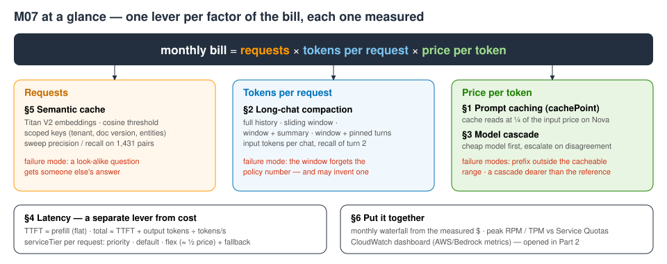
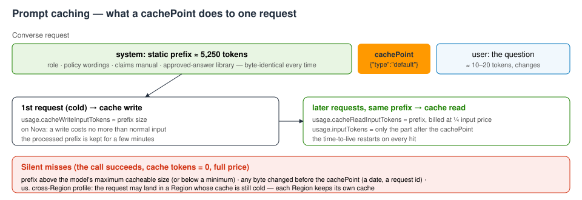
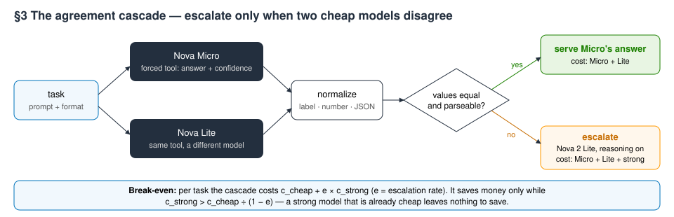
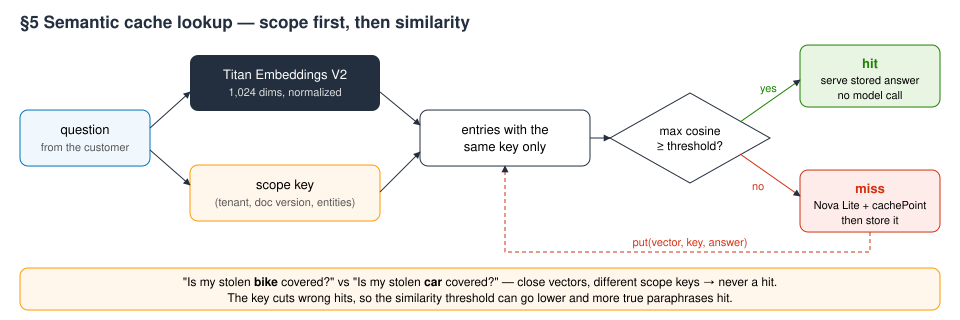

# M07 — Performance Optimization and Cost Management · hands-on demo
**Engineering the bill and the latency**

**Accompanies:** course deck module 7, slides 8–47 (Performance Optimization and Cost Management) — best done after slide 47, before the knowledge check (or split: §1–§3 after slide 22, §4 after slide 34, §5–§6 after slide 47) · **Services used:** Amazon Bedrock (Converse / ConverseStream, prompt caching, service tiers, cross-Region inference), Amazon Nova Micro / Lite / Pro / 2 Lite, gpt-oss-120b, Amazon Titan Text Embeddings V2, Amazon CloudWatch, Service Quotas · **Cost per run:** ≈ $0.11 (the Nova Pro arm ≈ $0.05, Nova 2 Lite with reasoning ≈ $0.04, everything else < $0.02) · **Duration:** notebook ≈ 20 min, console ≈ 15 min · **Prep:** none beyond §0 (≈ 3 s)

> **How this guide was verified.** The notebook was run end to end, live, in us-east-1 in October 2026 (several runs; every *Expect* line is the range we measured). The console steps were **not** clicked through: the state they show (the dashboard, metric names and dimensions, quota names and values, inference-profile Regions) was verified through the equivalent API calls, so page, tab and button names may differ slightly from what you see.

> **Reading the notebook.** Lines worth slowing down for carry a `# ▶ KEY` comment, and every section uses the same boxes: 💡 Concept (the idea before the code), 🔑 Key code (where to look), 📊 How to read this (after the output) and ✅ Takeaway (what to remember). A Summary table at the end recaps what you built.

## What you will learn
- How to measure the cost of a request as **requests × tokens per request × price per token** — and which lever moves which factor.
- Prompt caching with a `cachePoint`: what it saves, where it **silently does nothing**, in-Region model id vs. the `us.` cross-Region profile, and whether it buys latency on Nova (a bootstrap confidence interval decides).
- Context compaction for a long chat: full history vs. a sliding window vs. window + summary vs. window + pinned turns — tokens per chat, and which one still remembers a policy number from turn 2.
- A **model cascade** (cheap model first, escalate when unsure): why self-reported confidence fails as a signal, why agreement of two cheap models works, and when a cascade does not pay at all.
- TTFT vs. total latency, and **service tiers** (priority / standard / flex) per request with a fallback for models that don't support them.
- A **semantic cache** tuned as a classifier (zero wrong answers allowed), entity-scoped cache keys, and a replay of traffic through it.
- A monthly cost waterfall, a capacity check against your account's Service Quotas, and a CloudWatch dashboard.



## Before you start
1. **Set up the environment** once, from the repository root (see [the README](../README.md)):
   ```bash
   ./setup_env.sh
   .venv/bin/jupyter lab notebooks/
   ```
   Open [`M07_engineering_the_bill.ipynb`](../notebooks/M07_engineering_the_bill.ipynb) with the kernel **MLAIDP (Python 3.12)**.
2. **Credentials:** the notebook uses the standard AWS credential chain. If you use a named profile, start Jupyter with `AWS_PROFILE=<your profile>` set. Region: us-east-1. The §0 banner prints the account, Region and profile it found.
3. **Model access** (Amazon Bedrock → Model access) for:
   - `amazon.nova-micro-v1:0`, `amazon.nova-lite-v1:0`, `amazon.nova-pro-v1:0` (in-Region ids and their `us.` profiles)
   - `us.amazon.nova-2-lite-v1:0`
   - `openai.gpt-oss-120b-1:0`
   - `amazon.titan-embed-text-v2:0`
4. **Quotas that matter:** on-demand and cross-Region requests per minute for Nova Lite and Nova Pro. Our test account had applied quotas of a tenth of the AWS defaults (Nova Lite 200 requests/min on demand, 400 cross-Region; Nova Pro cross-Region about 50) and the notebook ran fine with adaptive retries — throttling makes cells slower, it does not make them fail. Don't run another notebook against the same models at the same time.
5. **What it creates:** one CloudWatch dashboard, `mlaidp2-m07-cost-latency` (in §6). Everything else only calls models.
6. **Don't use Run All.** The last cell is the cleanup and deletes the dashboard that Part 2 opens.

## Part 1 — the notebook (≈ 20 min)
Total cell time is about 2½ minutes; the slow cells are the cascade (96 calls, 35–46 s), the semantic-cache replay (31–34 s), service tiers (15–17 s), the latency sweep (≈ 12 s) and the four caching arms (≈ 9 s).

### §0 Setup and the workload · slides 8–9
The workload is AnyCompany Insurance's support assistant. Every request carries the same static prefix — role, the home and motor policy wordings, the claims manual, a library of approved answers (≈ 23,000 characters) — and then a short customer question. One function, `converse_measured`, makes every call on the page: **ConverseStream** for time to first token (TTFT), the final `metadata` event for token usage (including `cacheReadInputTokens` / `cacheWriteInputTokens`), and a price table for dollars.

- **Key code to read:** `converse_measured`, the helper every later section uses. `serviceTier` is chosen per request; the first text delta of the stream is the time to first token; the final `metadata` event carries the usage (including cache read and write tokens) and the tier that actually served the call; and a guard flags a complete answer whose usage block is all zeros, so it stays out of the cost averages.

**What to look for:** an 8-word question becomes a 5,254-token request. Almost everything you pay for on the input side is context you assembled yourself.

**Expect:** one call ≈ 600–800 ms to first token, 5,254 input tokens, ≈ $0.0003.

### §1 Price per input token: prompt caching · slides 11–12, 31
1. **The envelope.** The same call twice, with prefixes of five sizes and a `cachePoint` after each. The run id and a timestamp at the front make every probe start with a cold cache.
2. **Four arms** on the twelve questions, interleaved: Nova Pro without cache (the expensive baseline), Nova Lite without cache (right-sized), Nova Lite with a `cachePoint` on the **in-Region** id, and the same through the **`us.` cross-Region profile**.
3. **Bootstrap** of the median TTFT difference between cached and uncached, with a 95 % interval.



- **Key code to read:** in `cache_probe`, the `cachePoint` block at the end of `system` — everything before it is the cacheable prefix — and the identical second call, whose `cacheReadInputTokens` decides "cached?". In `ARMS`, the two cached arms that differ only in the model id (in-Region vs `us.` profile). In `arm_summary`, `billed(rs)` keeps only complete usage blocks for the token and dollar columns. In the bootstrap cell, each arm is resampled with replacement 4,000 times; the spread of the median difference is the uncertainty.

**What to look for:**
- The largest prefix gets an answer, no error — and zero cache tokens in the usage block. You pay full price and nothing tells you. Assert on the usage block in your tests, not only on the answer.
- Right-sizing (Pro → Lite) is a price-per-token lever of about 13×. The cache then moves ≈ 5,235 of the 5,254 input tokens to the cache-read price (a quarter of the input price on Nova; cache writes cost nothing extra on Nova).
- The cache lives in one Region. Through the `us.` profile a request can land in a Region whose cache is cold. In our October runs both arms hit almost every time, but an earlier test hit only about half the time through `us.` — measure your own hit rate.
- Some streams return an **all-zero usage block** although the answer is complete. A cost tracker that sums client-side usage under-counts; CloudWatch `InputTokenCount` (§6) and invocation logs (module 8) are the billing truth.
- Twelve TTFTs per arm are noisy. If the interval contains 0, this data cannot claim a latency gain. On Nova at about 5,000 tokens, caching is a **cost** lever, not a latency lever.

**Expect:**
- Envelope: prefixes of 271 / 1,363 / 5,261 / 10,497 tokens are cached; **36,677 tokens → "NO - and no error"**, and the ✓ line names that size as silently uncached.
- $ per 1,000 requests: Nova Pro ≈ $4.28–4.29, Nova Lite ≈ $0.32, Lite + cache in-Region ≈ $0.089 (every billed stream hits, e.g. 11/11), `us.` ≈ $0.081–0.089 (10–12 of the billed streams hit).
- TTFT p50: Pro 385–600 ms, Lite 340–390 ms, in-Region cache 360–460 ms, `us.` 500–575 ms. Empty usage blocks: 1–5 of 48 streams.
- TTFT saved: between −68 and +20 ms; the interval contained 0 in 5 of 6 runs (once the cached arm was measurably *slower*). Last line: "✓ cost per request with the in-Region cache: 73% lower than without".

**Think about it:** A request through the `us.` profile can be served in another Region whose cache is cold. When is the `us.` profile still the right choice for a cached workload? (More questions in the notebook: a date in the first line of the template; what to compress first when the prefix is cached.)

### §2 Tokens per request: long conversations · slides 10, 13–14
Converse is stateless: every turn resends the whole history, so a 30-turn chat pays for turn 1 thirty times. Four strategies on the same chat; at turn 30 the customer asks for the policy number they gave **once**, in turn 2:
- full history;
- the last 8 turns;
- the last 8 turns + a running summary written by Nova Micro;
- the last 8 turns + **pinned turns** (a regex keeps every turn that contains an identifier, verbatim).

- **Key code to read:** `strategies(n)` — the sliding window is just `history(n - WINDOW, n)`, and both the summary and the pinned turns are added to the *system prompt*. `pinned()` is a single regex (`ID_PATTERN`) that keeps every older customer turn containing an identifier or an amount, verbatim and without a model call.

**What to look for:**
- Full history grows linearly per turn — so the whole chat grows quadratically.
- The 8-turn window halves the tokens and, in our runs, **invented** a policy number. A made-up answer is worse than "I don't know": nothing in it tells the customer it is wrong.
- Both repairs keep the window's savings and get the number right. Pinning only a list of the extracted IDs did *not* work when we tried it (the model ignored it); pinning the whole turn does.

**Expect:** input tokens at turns 10 / 20 / 30 — full history 242 / 461 / 691 (10,830 for the whole chat) ✓; last 8 turns 186 / 176 / 185 (4,637) ✗ "Your policy number is 123456789."; + summary ≈ 220 / 230 / 250–260 (≈ 5,890–5,950) ✓; + pinned turns 214 / 204 / 213 (5,351) ✓. If the window answers "I don't have that information" instead, it is still ✗ — just the better kind of failure.

**Think about it:** If the window lost the policy number, did it say "I don't have that information" or invent one — which failure is worse? Which of the two compacting strategies would you trust with a claim amount?

### §3 Price per token, safely: a model cascade · slides 15–17
Twenty-four support tasks whose answers a program can check (8 classifications, 6 extractions, 6 calculations, 4 reasoning questions). Every task goes **once** to Nova Micro (cheap), Nova Lite (cheap, a different model), Nova 2 Lite with reasoning (strong) and gpt-oss-120b (reference); every policy in the table is computed from those same 96 calls. The cheap models answer through a **forced tool call** — the answer plus a self-reported confidence — and graders normalize every answer, which is also what "two models agree" means.

Two cascade policies:
- **self-confidence:** escalate when Nova Micro reports confidence below 0.9;
- **agreement:** ask Nova Micro *and* Nova Lite; escalate when their answers differ.

Then calibration, a paired bootstrap (accuracy difference and cost ratio of the agreement cascade vs. the strong model), and a break-even formula: a cascade pays only while *c_cheap + e × c_strong < c_strong*, i.e. the strong model must cost more than *c_cheap / (1 − e)*.



- **Key code to read:** `ANSWER_TOOL` with a forced `toolChoice`, so every model returns a structured answer plus a confidence; the reasoning switch passed in `additionalModelRequestFields` (reasoning tokens are billed as output, so it also raises `maxTokens`); `normalize()`, which defines what "the two answers agree" means; in `policy_result`, the escalation branch (cheap calls plus the strong call are paid, the strong answer is used) and the agreement test; and the paired `bootstrap_ci`, which resamples the same task indices for both policies.

**What to look for:**
- The confidence column: 0.95–0.99 on every task, right or wrong. Self-reported confidence is not a signal — the self-confidence cascade never escalates and is exactly as good (or bad) as Micro alone.
- When Micro and Lite agree they are right about 90 % of the time; disagreement escalates roughly half of the tasks (all of the math).
- The agreement cascade matches the strong model at about two thirds of its cost; the interval on the accuracy difference spans roughly ±12 %, so with 24 tasks "no loss" means "no loss this data can detect".
- The reference row: gpt-oss-120b got 24/24 at a fraction of the cascade's cost. The break-even line explains why a cascade in front of it would not pay. Evaluate your candidates first (module 1), then engineer.

**Expect:** Nova Micro 11–12/24 ($0.023 / 1k tasks); Nova 2 Lite with reasoning 20–23/24 ($1.37–1.75 / 1k); self-confidence cascade = Micro only, 0 escalations; agreement cascade 20–22/24 with 13/24 escalated, $0.90–1.18 / 1k; cost ratio 58–68 % (interval ≈ 35–86 %); "✓ the agreement cascade is cheaper than the strong model with no accuracy loss this data can detect"; gpt-oss-120b 24/24 at $0.093–0.098; break-even ≈ $0.135 / 1k → "a cascade in front of it would not pay". Nova 2 Lite with reasoning varies from run to run; if the ✓ line ever flips, read the accuracy interval — 24 tasks cannot separate 20 right from 22.

**Think about it:** Self-reported confidence vs. agreement of two cheap models: which would you put in production, and what does each cost you when it is wrong? (More in the notebook: which task kinds should never start on the cheap model; which tasks a deterministic validator could check instead of a second model.)

### §4 Latency: what the user waits for · slides 10, 27, 31
1. The same request asking for answers of 20, 80, 200 and 400 words, twice each, with a linear fit of total latency against output tokens, and a chart.
2. A **service tier probe**: one request per model with `serviceTier` set to flex.
3. **Tiers** on Nova 2 Lite: the same six questions at priority, standard (`default` in the API) and flex.

- **Key code to read:** the `np.polyfit` line — total latency ≈ intercept + slope × output tokens, so the slope is milliseconds per output token and 1000 ÷ slope is tokens per second. In `converse_tiered`, exactly one error ("service tier is not supported") falls back to the default tier; every other error is raised.

**What to look for:**
- TTFT stays flat (it is mostly prefill); total latency is a straight line in output tokens, and the slope is the generation speed. Asking for shorter answers is a latency lever as well as a cost lever (on Nova Lite, output tokens cost 4× the input price).
- Streaming doesn't shorten the total; it shows the first words after TTFT instead of after the total.
- Tiers are set per request, but not every model has them. Nova Micro and Nova Lite reject the parameter with a `ValidationException`, and `converse_tiered` falls back to the default tier instead of failing the customer's request.
- Flex costs about half; priority costs about 1.75×. On an idle account priority isn't faster — it buys consistency under load, which this table cannot show.

**Expect:** total ≈ 285–460 ms + 4.0–5.5 ms per output token (R² 0.98–0.99, ≈ 180–255 tokens/s); TTFT 230–390 ms at any length; "✓ output length drives total latency, not TTFT". Probe: Nova Micro and Nova Lite "default (fallback)"; Nova 2 Lite, Nova Pro and gpt-oss-120b served as flex. Tiers: p50 totals within about 150 ms of each other (740–1,030 ms); $ / 1k ≈ $0.30–0.32 priority, $0.18 default, $0.09 flex; "✓ flex costs 49–51 % of default".

**Think about it:** Compare the priority and default latencies. What does priority buy you, and under what conditions would the table show it? (More in the notebook: which AnyCompany workloads belong on flex; what a router should do when the monthly budget hits 90 %.)

### §5 Number of requests: a semantic cache · slides 37–46
A request the cache answers never reaches a model. The cache embeds each question with Titan Text Embeddings V2 and returns a stored answer whenever a new question lies within a similarity threshold of a stored one. The threshold is a correctness decision, so it is measured like a classifier: 54 questions in 12 answer groups (a question and two paraphrases each), plus 12 look-alikes with a *different* answer and 6 unrelated questions.

1. **Pairs:** any answered question becomes a cache key, so every pair of the 54 is evaluated — 1,431 pairs, 36 of which share an answer.
2. **Sweep** of the threshold for vector-only keys and for **scoped keys** (a hit must also match tenant, document version and the perils / insured objects / actions named in the question; here a small hand-written vocabulary, in production your entity extraction).
3. **Replay:** the 54 questions in random order through an empty cache; a miss calls Nova Lite (with the cached prefix from §1) and stores the answer.



- **Key code to read:** `embed_one` asks Titan for normalized vectors, so a dot product is the cosine; `scope()` builds the entity part of the cache key (generic words removed); the pairs cell computes every cosine at once with `VECS @ VECS.T`; the sweep's `hit = (pair_sim >= t) & allowed` — a hit must be similar enough *and* in the same scope; `best_threshold` picks the lowest threshold whose precision meets the bar; and in `SemanticCache.get`, entries with another scope get −1 before the threshold decides, while a hit returns the stored answer with no model call.

**What to look for:**
- Look-alikes sit close together in embedding space while true paraphrases can be far apart. The pairs table shows both.
- With zero wrong answers allowed, vector-only keys need a high threshold and lose most of their recall; scoped keys allow a lower threshold and more hits. At 0.50, vector-only would serve 18 wrong answers, scoped keys 3.
- A hit answers in about 150 ms instead of about 700 ms and skips the model. But the threshold was tuned on these same questions: the replay shows hit rate, latency and cost, not how the threshold generalizes. That needs a held-out set from real traffic.

**Expect:** these numbers are the same in every run (embeddings are deterministic, the replay order is seeded). Closest different-answer pairs: "Is the new pipe covered?" vs. "Is water from a burst pipe covered?" 0.70, stolen bike vs. stolen car 0.67; most distant paraphrases: hotel vs. temporary accommodation 0.36. Zero-wrong thresholds: vector only 0.75 → 31 % recall; scoped 0.65 → 44 % recall. Replay: 12 hits of 54 (22 %), 0 wrong, "✓ no wrong answer served", hit p50 ≈ 135–170 ms vs. miss ≈ 685–735 ms, $ / 1k ≈ $0.069 with the cache vs. $0.088 without. If you ever see "✗ the cache served a wrong answer", the embedding model has changed — and it is the lesson of the sweep in action: a threshold tuned on 54 questions is not a guarantee.

**Think about it:** The threshold was tuned on 54 questions. What happens on the first day a customer asks about something the vocabulary doesn't know — and what would you monitor to catch it? (More in the notebook: which answers must never be cached; how a scope key makes invalidation one line when the policy wording changes.)

### §6 The bill, the quota and the dashboard · slides 18–19, 28
1. A **monthly waterfall** at 1 M requests: Nova Pro baseline → right-sized to Nova Lite → + prompt cache → + semantic cache.
2. A **capacity check**: the account's applied Service Quotas (requests and tokens per minute for Nova Lite) against the peak minute of that traffic.
3. A **CloudWatch dashboard** with invocations and throttles per model, cache-read tokens, TTFT p50, and Nova 2 Lite latency per service tier.

- **Key code to read:** in `STEPS`, the semantic-cache step — only misses reach the model, but every request pays one embedding; in `find_quotas`, the `NextToken` loop over `list_aws_default_service_quotas` and the `get_service_quota` call, because the value applied to your account can differ from the AWS default; the `peak_rpm` line (only cache misses consume quota); and `put_dashboard`, which creates or replaces the dashboard by name.

**What to look for:** right-sizing is the biggest step, and it is only safe with the evidence from §3. The quota check is about the peak minute, not the monthly total — and the semantic cache's hit rate is part of what keeps the peak under the quota.

**Expect:** $4,281–4,291 → $324 (7.6 %) → $89 (2.1 %) → $69–70 (1.6 %) per month. Quotas in our test account: on-demand Nova Lite 200 requests/min (AWS default 2,000), 4,000,000 tokens/min; cross-Region 400 requests/min (default 4,000); peak need ≈ 180 requests/min and ≈ 0.95 M tokens/min, so the quota is hit at ≈ 1.1 M requests a month. Your account's applied values may differ — the reasoning (peak vs. per-minute quota) holds. Dashboard "✓ created" with a non-zero invocation count; CloudWatch lags 1–3 minutes, so a 0 right after the run is normal. If the quota cell raises `KeyError`, a quota was renamed in Service Quotas — print the names `find_quotas` finds for "Nova Lite" and adjust the three names.

**Think about it:** Which single CloudWatch metric would you alarm on for this assistant — and with which statistic?

## Going deeper
- **How prompt caching is keyed.** A checkpoint can sit in `system`, `messages` or `tools`. The cache key is the exact prefix up to the checkpoint; an entry lives for about five minutes and each hit refreshes it. The minimum tokens per checkpoint, the number of checkpoints and the largest cacheable prefix vary by model — which is why §1 measures where Nova Lite stops caching rather than trusting a table. On Nova, writing to the cache costs the normal input price and reading costs a quarter; some other model families charge extra for writes.
- **Why caching hardly changes TTFT here.** With a prefix of about 5,000 tokens, prefill is only a small part of Nova Lite's few hundred milliseconds; queueing and network jitter dominate. The latency benefit grows with longer prefixes and larger models, so measure it on your own prompts and report an interval.
- **Client-side usage is not the bill.** A fully streamed answer can arrive with an all-zero `metadata.usage`. CloudWatch's `InputTokenCount` / `OutputTokenCount` and model invocation logs are measured on the server side — reconcile against those (module 8) and never charge tenants from client-side sums alone.
- **Why agreement beats self-confidence.** A model's stated confidence is generated text, not a probability it computed, and small models tend to state the same high number every time. Two *different* models make only partly correlated mistakes, so their disagreement is a usable error signal; a deterministic validator (schema check, date parser, formula) is better still where you can write one.
- **Service tiers.** On models that support them you pick priority, standard (`default` in the API) or flex per request; the response metadata and the `ResolvedServiceTier` dimension in CloudWatch tell you which tier really served it. Each tier is a multiplier on the on-demand token price — priority above it, flex roughly half.
- **A semantic cache in production.** Keep vectors and keys in a shared store such as ElastiCache for Valkey or OpenSearch vector search, filter on the scope tags *before* the nearest-neighbour search, give each entry a TTL, never cache personalised or time-sensitive answers, and log every hit with its similarity so a wrong hit can be traced and the threshold re-tuned.
- **Quotas.** Requests and tokens per minute are enforced per model and per Region, and cross-Region profiles have their own, larger quotas. Many are adjustable through Service Quotas; for steady high volume, Provisioned Throughput is the alternative.

## Questions to check your understanding
1. **Why not simply cache every prompt?**
   <details><summary>Answer</summary>Only a byte-identical prefix can hit. Anything that varies — a date, a user name, a retrieved chunk — has to come after the cache point, and a prefix outside the model's limits is not cached at all (silently, as §1 shows).</details>
2. **Is the semantic cache safe for questions about a specific claim?**
   <details><summary>Answer</summary>Only if the scope key includes the customer or the claim — otherwise not at all, because personalised answers must never be served to another user. The notebook caches generic policy questions only.</details>
3. **Why did the cascade lose to gpt-oss-120b?**
   <details><summary>Answer</summary>That reference model is both accurate and cheap on these tasks. The break-even formula shows a cascade only pays when the strong model is expensive compared with the cheap calls in front of it — evaluate your candidates first (module 1).</details>
4. **Priority was not faster in the table. Is it worth paying for?**
   <details><summary>Answer</summary>On an idle account no tier has to wait, so you cannot see the difference. Priority protects you when capacity is contended; measure it under load and alarm when the resolved tier differs from the one you requested.</details>
5. **Will the dollar figures match your invoice?**
   <details><summary>Answer</summary>Not exactly. The notebook multiplies client-side usage by list prices; the invoice comes from server-side metering. Expect small differences, and larger ones when usage blocks go missing.</details>

## Part 2 — the same in the console (≈ 15 min)
The same workload, seen from the operations side. **First run every cell above *Cleanup* in the notebook (≈ 2½ min); don't use Run All** — the dashboard and the metrics need the notebook's traffic, and Run All would delete the dashboard at the end. Do Part 2 within an hour of that run. Region: us-east-1. If other people use the same account, their traffic shows up in the Bedrock metrics too.

1. **The dashboard.** CloudWatch → **Dashboards** → `mlaidp2-m07-cost-latency`; set the time range to **1 h**.
   **Expect:** four views on one page — calls and throttles per model; input tokens read from the cache instead of billed; TTFT p50 per model; Nova 2 Lite latency per service tier. Spikes at the times you ran §1 and §4, and `CacheReadInputTokenCount` far above `InputTokenCount` for `amazon.nova-lite-v1:0`.
2. **Bedrock metrics per model.** CloudWatch → **Metrics** → **All metrics** → **Bedrock** → **ModelId** → select `amazon.nova-lite-v1:0` with **InputTokenCount**, **CacheReadInputTokenCount** and **OutputTokenCount**. On **Graphed metrics** set statistic **Sum** and period **1 minute**.
   **Expect:** the metrics exist per model id, alongside **TimeToFirstToken**, **InvocationThrottles** and **EstimatedTPMQuotaUsage**. This is the server-side token count that the notebook's client-side usage could not guarantee (remember the empty usage blocks).
3. **Per-tier metrics.** Same page → **Bedrock** → **ModelId, ResolvedServiceTier, ServiceTier** → `us.amazon.nova-2-lite-v1:0` with priority / default / flex → **Invocations**.
   **Expect:** the dimension set exists with all three tiers. The requested tier and the tier that actually served the request are separate dimensions — an alarm on the two differing tells you priority capacity ran out.
4. **Quotas.** Service Quotas → **AWS services** → **Amazon Bedrock** → search `Nova Lite` → open *On-demand model inference requests per minute for Amazon Nova Lite*.
   **Expect:** the applied value next to the AWS default, and (if adjustable) a **Request increase at account level** button — look, don't submit. Also find the cross-Region requests-per-minute quota and the on-demand tokens-per-minute quota for Nova Lite and compare them with the §6 table.
5. **Cross-Region inference profiles.** Amazon Bedrock → **Cross-Region inference** (under Infer) → **US Nova Lite** (`us.amazon.nova-lite-v1:0`).
   **Expect:** three destination Regions — us-east-1, us-east-2, us-west-2. That is more throughput than one Region's quota, and also three separate prompt caches (§1).
6. **Playground metrics.** Amazon Bedrock → **Playgrounds** → **Chat / Text** → Nova Lite. Send *"In about 20 words, explain how to file a home insurance claim after a burst pipe."*, then the same with 400 words, and open each response's model metrics.
   **Expect:** input tokens barely change, output and latency grow together — the line from §4. Not verified through the API; from the notebook's numbers, roughly 25 vs. 570 output tokens and about 0.45 s vs. 3–3.5 s total.

## Clean up
- Run the notebook's **Cleanup** section after Part 2. It deletes the dashboard and prints "✓ nothing left". Nothing else was created: every other step only called models.
- Part 2 creates nothing (step 4 only looks at the increase form). If you saved a playground session or edited the dashboard, there is nothing extra to remove beyond the dashboard itself.
- Check the account: `.venv/bin/python tools/sweep.py` lists anything named `mlaidp2` that is still there.
- Cost per run ≈ $0.11, all of it model calls; the dashboard is deleted before it accrues a monthly charge.
