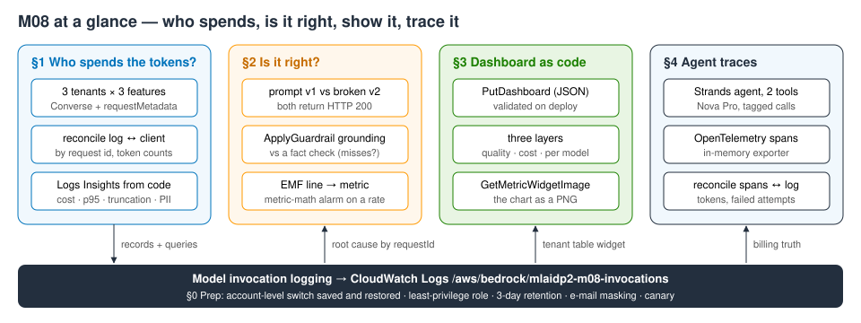
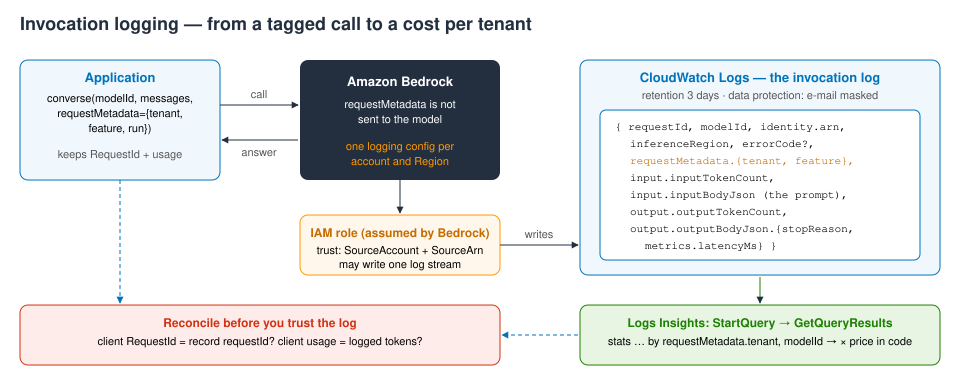
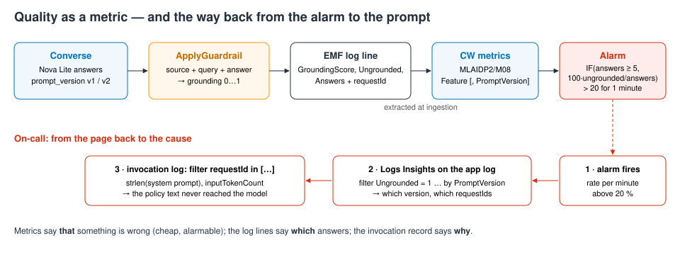
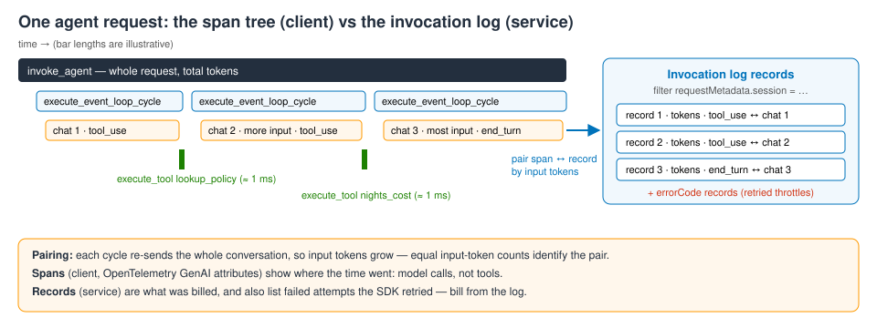

# M08 — Monitoring and Observability for Generative AI · hands-on demo
**Seeing quality, not just uptime**

**Accompanies:** course deck module 8 (deck title: Monitoring and Observability for Generative AI), slides 5–16 (the end of lesson 1); §2 previews slides 30–35 of lesson 3 · **Services used:** Amazon Bedrock (Converse, model invocation logging, Guardrails contextual grounding check), Amazon CloudWatch (Logs, Logs Insights, Embedded Metric Format, metric-math alarm, dashboard), AWS IAM, Strands Agents with OpenTelemetry · **Cost per run:** ≈ $0.02 · **Duration:** notebook ≈ 20 min, console ≈ 15 min · **Prep:** §0 Setup + §0 Prep (≈ 30–40 s) — it switches on **account-level** model invocation logging, see below

> **How this guide was verified.** The notebook was run end to end, cleanup included, in us-east-1 in October 2026; every *Expect* line is a range measured over several of those runs. The console part was **not** clicked through: the state each step shows (logging settings, log group, queries, guardrail scores, alarm, dashboard body) was verified through the equivalent API calls only, so page, tab and button names may differ slightly from what you see.

> **Reading the notebook.** Lines worth slowing down for carry a `# ▶ KEY` comment, and every section uses the same boxes: 💡 Concept (the idea before the code), 🔑 Key code (where to look), 📊 How to read this (after the output) and ✅ Takeaway (what to remember). A Summary table at the end recaps what you built.

> **Account-level setting — read this first.** Model invocation logging is **one** configuration per account and Region. While it is on, *every* Bedrock call in us-east-1 is logged — including the prompts and answers of anyone else using the account. The notebook therefore:
> - saves the configuration that was there before (once, to `notebooks/.m08_logging_before.json`) and restores exactly that in the Cleanup section;
> - never overwrites someone else's configuration: if one exists and writes to CloudWatch Logs, it reads that log group instead; if it writes to S3 only, §0 stops with an error and changes nothing.
>
> If you share the account, tell the others before you run §0, and don't leave the notebook without running the Cleanup.

## What you will learn
- How to switch on an account-level setting from code responsibly: read, save, write only if nobody owns it, restore exactly — with a least-privilege role, a retention period and a **data protection policy** that masks e-mail addresses in the log.
- How to attribute cost and latency to tenants and features with **`requestMetadata`** and **Logs Insights queries run from code** — and why a log only counts as evidence after you reconcile it with what the client sent.
- How to turn answer quality into a metric: a **contextual grounding** score per answer, published as **EMF** log lines, an alarm on a **rate with a minimum sample**, and a three-layer **dashboard defined as JSON**.
- How to read the **OpenTelemetry spans** of a Strands agent and check them call by call against the invocation log, which is the billing truth.



## Before you start
1. **Environment** (once): from the repository root run `./setup_env.sh` (needs `uv`), then `.venv/bin/jupyter lab notebooks/` and open [`M08_seeing_quality.ipynb`](../notebooks/M08_seeing_quality.ipynb) with the kernel **MLAIDP (Python 3.12)**. See the [README](../README.md).
2. **Credentials:** the standard AWS credential chain of your sandbox account; set `AWS_PROFILE` if you use a named profile. Region us-east-1. Your identity needs Bedrock, CloudWatch Logs/metrics/alarms/dashboards and IAM role creation (the notebook creates `mlaidp2-m08-bedrock-logging`).
3. **Model access** (cross-Region inference profiles): `us.amazon.nova-micro-v1:0`, `us.amazon.nova-lite-v1:0` and `us.amazon.nova-pro-v1:0` (the agent in §4).
4. **Quotas:** Nova Pro cross-Region requests per minute matter for §4 — in a busy shared account we saw throttled attempts (they show up in the log, see §4).
5. **Logging:** check whether someone else already uses model invocation logging in your account (Bedrock console → *Settings*). See the box above.
6. **Run §0 Setup and §0 Prep** (≈ 30–40 s). **Don't use Run All** — the last two cells are the Cleanup, which switches logging off and deletes everything the console part needs.

**Expect from §0:** a banner with your account, us-east-1 and a run id; "logging configuration now: none" (or the existing one, adopted); "✓ model invocation logging ON → /aws/bedrock/mlaidp2-m08-invocations (role usable after 0–10 s)"; "✓ invocation records arrive: first canary visible after 8–14 s"; the guardrail and the app log group `/mlaidp2-m08/app` ready.

**Key code to read in §0:** in `logging_owner`, the read of the account-level switch before anything is changed; the `if not SAVED.exists()` line, which snapshots the original state exactly once (a re-run must not save *your* configuration as "the original"); the 3-day retention, `put_data_protection_policy` (e-mail addresses masked for anyone without `logs:Unmask`) and the role's `TRUST` policy (only Bedrock acting for this account may assume it); the single `put_model_invocation_logging_configuration` call, made only when nobody owns the switch and retried until the new role can be assumed; in `insights`, `start_query` returning just an id and the polling of `get_query_results` (every value comes back as a string); and the canary call whose record must appear before the pipeline is trusted.

**What to look for in §0:**
- The single line that changes the account is `put_model_invocation_logging_configuration`. Everything around it — read first, save once, restore — is the pattern you'd use for any account-wide switch.
- The role may write only to one log stream, and its trust policy pins `aws:SourceAccount` and `aws:SourceArn` (the confused-deputy guard).
- Prompts are data: 3-day retention, and a data protection policy that shows asterisks to anyone without `logs:Unmask`.
- "Prove it, don't assume it": a canary call has to appear in the log before the demo trusts the pipeline. A fresh configuration needs a few seconds to reach every endpoint; calls in that window are not logged.

## Part 1 — the notebook (≈ 20 min)

### §1 · Who spends the tokens? (slides 5–7, 14, 15)
**What the code does:** AnyCompany Insurance's assistant API serves three broker partners (tenants `fabrikam`, `contoso`, `northwind`) with three features — `faq` (Nova Micro, a short question), `email-reply` (Nova Lite, `maxTokens` 80) and `claims-assist` (Nova Lite, the whole policy wording and claims manual with every question). It sends 32 calls, each tagged with `requestMetadata` (tenant, feature, prompt version, run tag), waits for the invocation records, then runs Logs Insights queries from code: reconciliation, cost per tenant, latency per feature, stop reasons and the most expensive prompts.



- **Key code to read:** `converse_tagged` passes `requestMetadata=` (the attribution travels into the log record; the model never sees it) and keeps the `RequestId`, the join key into the log. The `RUN` tag is what every later query filters on, so re-runs never double-count. In the reconciliation cell, the `logged` dict keyed by request id and the `missing` list prove completeness. `Q_TENANT` groups by tenant **and** `modelId`, because the price depends on the model, and the price join happens in Python per model; the latency query computes percentiles and output tokens per second per feature; `Q_STOP` counts stop reasons per feature — where truncation hides.

**What to look for:**
- `requestMetadata` is written into the log record; it is never sent to the model. That is the right place for tenant or user ids — not a CloudWatch metric dimension.
- **Reconcile first.** Every client request id should have a record, and the token counts should match call by call. In our runs, 1 of 32 records occasionally never arrived — a log you haven't reconciled is not evidence for a bill.
- **Cost per tenant** is a join: Insights sums tokens per tenant *and* model; the prices are applied in Python. `fabrikam` makes about a third of the calls and pays two thirds of the cost — the whole manual travels with every prompt.
- **Output tokens per second** tells a slow model apart from a long answer.
- **Truncation returns HTTP 200.** `email-reply` stops at `max_tokens` every time; only the log's `stopReason` reveals it.
- The top prompts are a short question plus ≈ 1,850 tokens of documents; the e-mail address in an `email-reply` prompt is shown as asterisks.

**Expect:** 32 calls in 5–6 s; "32/32 records visible after ≈ 15 s"; "✓ every call has its invocation record" and "✓ token counts in the log equal the client's, call by call". Cost: fabrikam 10 calls, 14,889 input tokens, **67–68 %** of the cost (≈ $0.098 per 1k calls); contoso 24 % (≈ $0.036 / 1k); northwind 8–9 % (≈ $0.011 / 1k). Latency p50: faq 400–460 ms, claims-assist 470–580 ms, email-reply 670–830 ms; p95 600–1,000 ms; ≈ 60–86 output tokens/s for faq and claims-assist, ≈ 100–120 for email-reply (80 tokens, **100 % truncated**). "✓ e-mail addresses are masked in the log".

**If it goes wrong:** "⚠ 1 of 32 calls have no invocation record" (seen in about a quarter of our runs) is the lesson, not a bug: the cell names the missing request id, and the wait cell takes its full 90 s. Once, log delivery was badly degraded (7 of 32 records after 90 s): every check then prints ⚠ instead of failing and the tables show only what arrived — re-run the query cells a few minutes later.

**Think about it:** `fabrikam` makes about a third of the calls — compare that with its share of the cost. What would you change first: the tenant's price, the feature's prompt (retrieval instead of the whole manual, module 3), or a cache (module 7)?
<details><summary>More questions</summary>

- Why is `tenant` fine in `requestMetadata` but a bad metric dimension?
- The invocation log holds every prompt of every team in this account. Who should be allowed to read it?
</details>

### §2 · Is it right? Quality as a metric (slides 11–13, 15; preview of 30–35)
**What the code does:** a refund bot answers six policy questions with known answers in two versions. **v1** sends the policy wording with the question; **v2** is a release in which retrieval silently broke — same prompt, no documents. Each answer is scored with `ApplyGuardrail` (contextual grounding check in *detect* mode, `action: NONE`, threshold 0.75), and a deterministic fact check runs next to it so the detector itself can be measured. Each score becomes one EMF log line; an alarm uses metric math `IF(answers >= 5, 100 * ungrounded / answers, 0) > 20`; finally the code follows the ungrounded answers' `requestId` into the invocation log.



- **Key code to read:** in `grounding`, one `apply_guardrail(... source="OUTPUT")` call with three qualifiers (source, query, answer — no model call) and the filter entries it returns, one per type with a score and a detected flag; the prompt version written into `requestMetadata`; the `missed` / `false_alarms` lines that measure the detector against the fact check; in `emf_line`, the `_aws` block that declares which keys are metrics and which are dimension sets, with `requestId` kept as a plain property; the alarm's metric math, a rate evaluated only when a minute has at least 5 answers; `put_log_events` as the only write (no `PutMetricData`); `evaluatedDatapoints`, which shows which datapoints the alarm really used; and the `filter requestId in […]` query that leads from the metric's evidence to the exact prompt.

**What to look for:**
- Both versions return HTTP 200 in about the same time — an uptime dashboard stays green.
- **Score first, block later:** detect mode measures without changing behaviour.
- **Measure the detector.** Some wrong answers pass the threshold — "covers up to $2,000 for basement flooding" scores about 0.78 against 0.75. A grounding score is a signal, not a proof.
- EMF: CloudWatch extracts the metrics from ordinary log lines (no `PutMetricData`), and each line keeps the `requestId`.
- The alarm is a **rate** with a minimum sample, so one bad answer at 3 a.m. doesn't page anyone.
- Metrics page someone; logs explain why: the v2 call carried a 125-character system prompt and no policy text.

**Expect:** v1 6/6 facts correct, mean grounding **0.97–0.98**, 0 flagged; v2 0–1/6 correct, mean **0.40–0.58**, 3–5 flagged; missed 0–2 (the flood answer 0.77–0.80, sometimes the jewelry answer ≈ 0.76), false alarms 0–1; "✓ the broken release is visible". The alarm fires **25–120 s** after the scores are written ("Threshold Crossed: … [25–42 …] was greater than the threshold (20.0)"). Root cause: `system_prompt_chars` 125, `tokens_in` ≈ 38–39.

**If it goes wrong:** the alarm wait lasts up to 3 minutes. An alarm evaluates the latest datapoint of a several-minute look-back window, so on a re-run it may still sit in ALARM from the previous run — the cell resets it once and waits for this run's minute. If CloudWatch is slower, the cell prints "⚠ the alarm has not evaluated this run's minute …"; carry on (the root-cause cell reads logs, not the alarm) and check the alarm's *History* later (Part 2, step 5). If v2 happens to answer well, the "broken release" check still compares the means.

**Think about it:** the grounding check missed a wrong answer (if it did in your run — read the "missed" line). What would you add before you let this check **block** answers instead of only scoring them?
<details><summary>More questions</summary>

- Why alarm on the rate with a minimum sample rather than on the lowest score?
- If the alarm said "v2 is broken" within a minute or two, how would you roll back automatically (module 1's AppConfig)?
</details>

### §3 · One dashboard, three layers — as code (slide 10)
**What the code does:** builds a dashboard body in JSON with an executive row (ungrounded rate, the alarm), an operational row (tokens per tenant from the invocation log, grounding per prompt version) and a diagnostic row (p95 latency, time to first token, throttles per model from `AWS/Bedrock`), validates and deploys it, and renders one widget server-side with `GetMetricWidgetImage`.

- **Key code to read:** the `RATE` expression, reused from the alarm so the dashboard shows exactly what would page someone; the `x` / `y` / `width` of each widget (a 24-unit grid, one row per layer); the log widget's `SOURCE '…'` query; `put_dashboard(...)`, where an empty `DashboardValidationMessages` list means the body is valid; and `get_metric_widget_image`, which renders a widget server-side and returns PNG bytes.

**What to look for:** the dashboard is a reviewable file — version-controlled and deployed like code. The same widget JSON renders as an image for reports, runbooks or chat-ops.

**Expect:** "✓ dashboard valid · 8 widgets" and a console link; a bar chart with prompt v2 far above the 20 % line and v1 at 0.

**Think about it:** which widget would you show the CFO, which one the on-call engineer — and which one would you delete because nobody makes a decision with it?

### §4 · Traces: what an agent did, step by step (slides 14, 15)
**What the code does:** a Strands agent on Nova Pro with two tools (`lookup_policy`, `nights_cost`) answers a hotel-cost question. An in-memory OpenTelemetry exporter captures its spans (GenAI semantic conventions); the code prints the span tree and reconciles every `chat` span with its invocation record.



- **Key code to read:** the tracer provider with a `SimpleSpanProcessor` and an `InMemorySpanExporter`, so Strands' spans land in a Python list (a guard handles the fact that the global provider can be set only once per process); `additional_args={"requestMetadata": AGENT_TAGS}`, which makes every model call of the agent carry your tags into the invocation log; the span tree rebuilt from parent span ids; and in the reconciliation cell, the `errorCode` line (failed attempts only the service records) and the pairing of spans and records by input tokens, since each cycle re-sends a longer conversation.

**What to look for:**
- The tree: `invoke_agent` → one `execute_event_loop_cycle` per step → a `chat` span (the model call, with tokens) and `execute_tool` spans. Model time is nearly everything; tools take milliseconds.
- Input tokens grow every cycle — the whole conversation is re-sent.
- The log also records **failed attempts** (`errorCode`, e.g. a throttled call the SDK retried); a trace shows them only as a slow `chat` span. When the two disagree, bill from the log.
- In production you'd export the spans over OTLP to CloudWatch generative AI observability (which needs Transaction Search — another account-level setting) or your own collector.

**Expect:** "✓ the agent's answer contains the expected amount 4,500"; 3 model calls, input ≈ 560 → 760 → 900 tokens (≈ 2,200–2,240 in, 240–305 out in total); `invoke_agent` 3.4–5.7 s; tool spans ≈ 1 ms; "✓ every successful chat span has its invocation record (3 spans, 3 records)"; "✓ tokens agree call by call"; failed attempts usually none — in a busy shared account we saw 1–9 `ThrottlingException` records and one 10 s `chat` span.

**If it goes wrong:** "⚠ the spans miss N tokens" was seen once in testing (Strands reported 0 tokens for a final call) — exactly why the log is the one to bill from.

**Think about it:** input tokens grow with every cycle. Why — and what does that mean for the cost of an agent that needs ten steps instead of three?
<details><summary>More questions</summary>

- Which attribute would you add to every span so a support ticket can be traced to one agent session?
- The invocation log already has the prompts. What do traces add that the log cannot?
</details>

## Going deeper
- **What a log record contains.** One record per `Converse`, `ConverseStream`, `InvokeModel` or `InvokeModelWithResponseStream` call, successful or not: schema type, timestamp, account, caller ARN, Region, request id, operation, model id, the inference Region for cross-Region profiles, your `requestMetadata`, token counts and — for the data types you enabled — the request and response bodies. Failed calls carry an `errorCode`. With a CloudWatch Logs destination, bodies over 100 KB (and binary image data) go to the S3 bucket set in `largeDataDeliveryS3Config`; the notebook's text calls are far below that.
- **Who can read the prompts.** Anyone allowed `logs:GetLogEvents` or `logs:StartQuery` on the log group. A data protection policy masks the identifiers you list for everyone without `logs:Unmask`; for regulated data, add a customer-managed KMS key to the group and restrict its key policy. For long-term audit, S3 delivery (lifecycle rules, Object Lock) is the usual choice.
- **`requestMetadata`.** Up to 16 string key–value pairs per request, written only to the log — never to CloudWatch metrics or to the model. It is also present on the record of a *failed* call, which is how §4 can count the throttled attempts of one agent session.
- **EMF rules.** The `_aws` object must sit at the top level of the JSON log event. Each inner `Dimensions` list is its own dimension set, i.e. its own metric series and its own metric charge; a set holds at most 30 dimensions and a line at most 100 metrics. Lambda and the CloudWatch agent emit EMF the same way, so the hot path needs no SDK call.
- **Rate with a minimum sample.** `IF(answers >= 5, …, 0)` treats a low-traffic minute as healthy, and with `TreatMissingData=notBreaching` a quiet night never pages anyone. For low-volume features, use a longer period (5–15 min) rather than a 1-minute rate; "M of N" (`DatapointsToAlarm` below `EvaluationPeriods`) is the next knob against flapping.
- **CloudWatch generative AI observability.** Its curated model view reads the same invocation logs; its agent traces come from OTLP spans (for example from AgentCore or ADOT) and require **Transaction Search**, another account-level setting. Strands follows the same OpenTelemetry GenAI semantic conventions you see in §4.

## Questions to check your understanding
1. **Why aren't the built-in AWS/Bedrock metrics enough?**
   <details><summary>Answer</summary>They are per model and account-wide: they show that spending went up, not which tenant, feature or prompt version caused it. Attribution needs context that only your application has — hence `requestMetadata`.</details>
2. **Why not make `tenant` a CloudWatch metric dimension?**
   <details><summary>Answer</summary>Every distinct dimension value creates a new custom metric, billed per metric per month, and high-cardinality dimensions make dashboards unreadable. Keep the tenant in the log and aggregate with Logs Insights.</details>
3. **Is the grounding check good enough to block answers?**
   <details><summary>Answer</summary>Not until you have measured it: §2 shows wrong answers scoring just above the threshold. Count misses and false alarms on labelled traffic from your own domain first (the calibration in module 9), then decide.</details>
4. **Does invocation logging slow down your calls?**
   <details><summary>Answer</summary>No — delivery is asynchronous, after the response. The cost is log ingestion and storage, plus the risk of holding prompts.</details>
5. **Why can the spans and the log disagree?**
   <details><summary>Answer</summary>Spans are produced by the client library from what it saw; the log is written by the service. Retried failures, a library reporting 0 tokens, or a dropped record all show up as gaps — and the log is what you are billed for.</details>

## Part 2 — the same in the console (≈ 15 min)
This part uses the notebook's resources: **run every cell above Cleanup first** (§0–§3, and §4 if you want traces; ≈ 2–5 min) and **don't use Run All** — Run All ends with the cleanup, which switches logging off and deletes everything below. Do this part within an hour of the notebook run so the queries and the dashboard have data. Region us-east-1.

1. **Model invocation logging** — Amazon Bedrock console → *Settings* (bottom of the left navigation) → *Model invocation logging*.
   **Expect:** logging on; data types *Text* only; destination *CloudWatch Logs only*; log group `/aws/bedrock/mlaidp2-m08-invocations`; service role `mlaidp2-m08-bedrock-logging`. Look, but don't click *Save* or switch it off here — the notebook's Cleanup restores the previous state.
2. **The log group** — CloudWatch → *Logs* → *Log groups* → `/aws/bedrock/mlaidp2-m08-invocations`. Check *Retention* (3 days) and the *Data protection* tab (EmailAddress, audit + mask). Open the stream `aws/bedrock/modelinvocations` and expand one record: `requestMetadata`, `input.inputTokenCount`, `output.outputBodyJson.stopReason`, `metrics.latencyMs`, `inferenceRegion` (cross-Region calls are served in us-east-1, us-east-2 or us-west-2), `identity.arn`.
   **Expect:** the notebook's records; an `email-reply` prompt shows `*****************` instead of the address.
3. **Logs Insights** — CloudWatch → *Logs Insights* → select the log group, time range *Last 1 hour*, and run:
   ```
   filter requestMetadata.tenant like /./ | stats count(*) as calls, sum(input.inputTokenCount) as tokens_in by requestMetadata.tenant, modelId | sort tokens_in desc
   ```
   then:
   ```
   filter requestMetadata.feature like /./ | stats count(*) by requestMetadata.feature, output.outputBodyJson.stopReason
   ```
   These are the same queries the notebook ran with `start_query`; *Save* one so others can reuse it. If other people use the account, their calls are in this log too — filter on your own metadata.
   **Expect:** fabrikam on top (≈ 14,900 input tokens per notebook run, Nova Lite plus a few Nova Micro); `email-reply` only with `max_tokens`.
4. **The grounding check** — Amazon Bedrock → *Guardrails* → `mlaidp2-m08-grounding` → *Test* pane. Enable the contextual grounding test. *Reference source* = the **whole** policy wording ([`assets/m03_docs/home_policy_wording_HP-2026.txt`](../assets/m03_docs/home_policy_wording_HP-2026.txt), as the notebook uses it — or at least section 2.3 *Escape of water* plus section 4 *Deductibles*; section 4 alone doesn't say that a burst pipe is escape of water). *Query* = "A pipe burst in my kitchen. What is my deductible?", *Response* = "Your deductible is 500 USD." → *Run*. Then change the response to "750 USD" and run again.
   **Expect** (API-verified with the full policy as source): "500 USD" grounding ≈ 0.1–0.2 (below the 0.75 threshold, detected); "750 USD" ≈ 0.9–0.99. Detect mode only scores — nothing is blocked.
5. **The alarm** — CloudWatch → *Alarms* → `mlaidp2-m08-ungrounded-rate`. Look at the graph, the *Details* (metric math `IF(answers >= 5, 100 * ungrounded / answers, 0)` > 20 for 1 of 1 minute), then *History*.
   **Expect:** ALARM shortly after the notebook's §2, back to OK or insufficient data a few minutes later; a history entry "INSUFFICIENT_DATA to ALARM". In production the alarm action would go to SNS or EventBridge and roll back the prompt version.
6. **The dashboard** — CloudWatch → *Dashboards* → `mlaidp2-m08-genai`, time range 1 hour. Walk the rows top to bottom, then *Actions* → *View/edit source*.
   **Expect:** the ungrounded-rate line with its 20 % annotation, the alarm widget, the tenant table from the invocation log, grounding per prompt version, and p95 latency / time to first token / throttles per model (these include anyone else using the account). The source is the JSON the notebook deployed.
7. *(Optional, not verified at all)* CloudWatch → *GenAI Observability* → *Model invocations*: a curated view over the same invocation logs. Agent traces there need **Transaction Search**, another account-level setting — don't switch it on in a shared account just for this.

## Clean up
- **After Part 2**, run the notebook's **Cleanup** section (two cells). In a fresh kernel, run the §0 Setup cell first — nothing else is needed.
  - The first cell restores the account's **model invocation logging** to what §0 saved — "✓ logging is 'none' again (saved original: 'none')" if nothing was configured before — and deletes the saved file. A configuration that belonged to someone else is never touched.
  - The second deletes the dashboard, the alarm, the guardrail, both log groups and the role: "✓ nothing left".
- Nothing to delete by hand from the console part (it only looks; the *Saved query* from step 3 is free — delete it in Logs Insights if you like).
- The custom metrics in the `MLAIDP2/M08` namespace can't be deleted; they expire on their own and cost nothing once no new data arrives.
- If a run was interrupted, check the account-level switch: `aws bedrock get-model-invocation-logging-configuration` (add `--profile` if you use one). If it still points to `/aws/bedrock/mlaidp2-m08-invocations`, run the Cleanup cells — they are safe to run twice.
- Finally: `.venv/bin/python tools/sweep.py` lists anything named `mlaidp2` that is left, plus the logging setting ([`tools/sweep.py`](../tools/sweep.py)).
- **Cost per run ≈ $0.02:** about 50 Nova calls, 12 contextual grounding checks, 3 Nova Pro agent calls and a few KB of logs.
