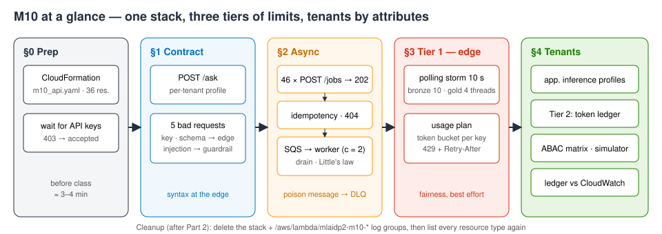
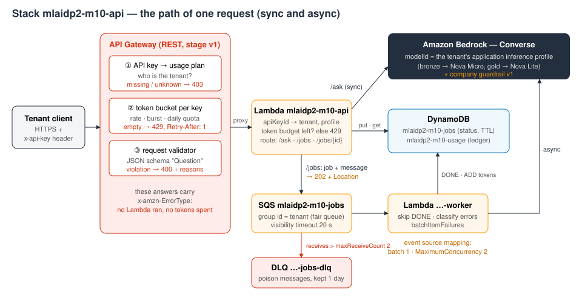
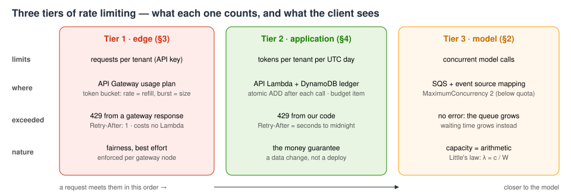
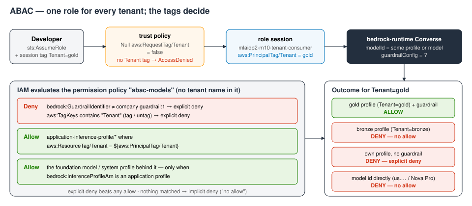

# M10 — Enterprise Integration Patterns · hands-on demo
**An enterprise GenAI API: front door, queue, tenants, attributes**

**Accompanies:** course deck module 10 (Enterprise Integration Patterns), slides 7–32, with slide 33 (API key rotation) as the natural next step · **Services used:** AWS CloudFormation, Amazon API Gateway (REST, usage plans, API keys), AWS Lambda, Amazon SQS (with a dead-letter queue), Amazon DynamoDB, Amazon Bedrock (Converse, Guardrails, application inference profiles, Nova Micro and Nova Lite), AWS IAM (ABAC, policy simulator), Amazon CloudWatch · **Cost per run:** ≈ $0.02 (an estimate: guardrail text units dominate; model tokens < $0.001) · **Duration:** notebook ≈ 20 min, console ≈ 15 min · **Prep:** run §0 Setup and §0 Prep in the notebook (≈ 3½ min the first time: stack creation 125–135 s, then 60–95 s until the new API keys are accepted; ≈ 5 s when the stack already exists)

> **How this guide was verified.** The notebook was run live in us-east-1 in October 2026, several times end to end, and every *Expect* below is a range measured over those runs. The console part was **not clicked through**: the state each console step shows (template, method settings, gateway responses, the *Test* results, usage plans, queue and trigger settings, table items, profile tags, metrics, role policies, simulator decisions) was verified through the equivalent API calls on the deployed stack. Page names, tab names and button labels come from the documentation and may differ slightly from what you see.

Notebook: [`../notebooks/M10_enterprise_genai_api.ipynb`](../notebooks/M10_enterprise_genai_api.ipynb) · Template: [`../src/m10_api.yaml`](../src/m10_api.yaml)

> **Reading the notebook.** Lines worth slowing down for carry a `# ▶ KEY` comment, and every section uses the same boxes: 💡 Concept (the idea before the code), 🔑 Key code (where to look), 📊 How to read this (after the output) and ✅ Takeaway (what to remember). A Summary table at the end recaps what you built.

## What you will learn
- How to read **one CloudFormation template** as the architecture of a production-shaped GenAI API: API Gateway with a JSON-schema **request validator** and JSON **gateway responses** (a 429 carries `Retry-After`), a **usage plan** per tenant, a synchronous route (`/ask`) and an asynchronous one (`/jobs`), SQS with a **dead-letter queue**, a worker Lambda whose **maximum concurrency** you choose, and DynamoDB for jobs and a token ledger — 36 resources in a single file.
- The **three tiers of rate limiting**, each measured: requests per tenant at the edge (a usage-plan token bucket answers 429 before any code runs), tokens per tenant in the application (a DynamoDB ledger answers 429 with `Retry-After`), and concurrency at the model (the queue absorbs the burst; Little's law predicts how fast it drains).
- **Async request-reply** done properly: 202 + `Location`, an **idempotency key** so a client retry does not create a second job, an idempotent worker for at-least-once delivery, error classification in the worker, and a poison message that ends up in the DLQ instead of blocking the queue.
- Every tenant as a **cost line**: an **application inference profile** per tenant with its own tags and its own CloudWatch metrics, and a reconciliation of the application's ledger with the platform's metrics.
- **One ABAC role for all developers**: a session tag decides which profile they may call, an explicit deny enforces the company guardrail, and the IAM policy simulator onboards a new tenant without any policy change.



## Before you start
1. **Environment.** From the repository root, once: `./setup_env.sh` (creates `.venv` and the Jupyter kernel), then `.venv/bin/jupyter lab notebooks/` and open the notebook with the kernel **MLAIDP (Python 3.12)**. See [`../README.md`](../README.md).
2. **Credentials.** The notebook uses the standard AWS credential chain; set `AWS_PROFILE` before starting Jupyter if you use a named profile. Region: us-east-1. Your identity needs to create a CloudFormation stack **with named IAM roles** (`CAPABILITY_NAMED_IAM`), and to assume a role in your own account with session tags (`sts:AssumeRole`, `sts:TagSession`) — an administrator sandbox has both.
3. **Model access.** The two application inference profiles copy the cross-Region system profiles `us.amazon.nova-micro-v1:0` (tenant bronze) and `us.amazon.nova-lite-v1:0` (tenant gold), which route to us-east-1, us-east-2 and us-west-2. Nova Pro appears only as a call that IAM is *expected* to deny — you do not need access to it.
4. **Quotas.** Nothing unusual: the worker runs at concurrency 2, far below the Nova quotas. A fresh API key is refused (403) for about 40–75 s after creation and may get a sporadic 403 on some API Gateway nodes for a few minutes — §0 Prep waits for that, and the notebook's client retries such a 403.
5. **Run §0 first, and never use Run All.** §0 Prep creates the stack `mlaidp2-m10-api` from [`../src/m10_api.yaml`](../src/m10_api.yaml) (idempotent: it creates, updates or adopts; a stack in `ROLLBACK_COMPLETE` is deleted and created again) and waits until both API keys are accepted. It prints `create complete` (or `adopted (template unchanged)`) and then `API keys ready`. The last section of the notebook deletes the stack, so Run All would remove what Part 2 needs.

All resources are named `mlaidp2-m10-…` and tagged `Project=mlaidp2-demo`.

## Part 1 — the notebook (≈ 20 min)

### §0 Setup and Prep
**What the code does:** prints your account (masked), Region and a run id; creates or adopts the stack (≈ 2 min the first time); then polls both API keys until no node returns 403.

- **Key code to read:** in `deploy_stack`, a stack whose first create failed is deleted and started again (it cannot be updated), an update changes only what differs ("no updates" means the stack is adopted as it is), and the waiter raises if the stack ends in a failure state; the `OUT` line, because generated ids (URL, ARNs, queue URLs) come only from the stack Outputs; and in `call_api_patiently`, a 4xx/5xx is kept as a response with its headers, a short `Retry-After` becomes the floor of an exponential backoff with jitter, and a long one (a budget's "come back tomorrow") goes straight back to the caller.

**Expect:** `stack mlaidp2-m10-api: create complete in 125–135 s`, the API URL (`https://<id>.execute-api.us-east-1.amazonaws.com/v1`), then lines like `API keys 9/10 still 403 (52 s)` counting down to `API keys ready after 60–95 s`. On a second run: adopted in about a second, keys ready at once.

### §1 The template is the architecture (slides 7–9, 30–31)
**What the code does:** lists the stack's resources by type, prints the template blocks that carry design decisions (the `Question` model, the `THROTTLED` gateway response, the bronze usage plan, the worker's event-source mapping), asks one synchronous question per tenant on `/ask`, then sends five probe requests.



- **Key code to read:** in the printed YAML, `additionalProperties: false` and `maximum: 400` in the `Question` model, `Retry-After` in the throttled gateway response, `RateLimit` / `BurstLimit` in the bronze usage plan and `MaximumConcurrency: 2` on the worker's event source mapping — each a design decision in a few lines; and in the probe cell, the `x-amzn-ErrorType` header, set by API Gateway itself — the proof that no Lambda and no model ran.

**What to look for:**
- **One file is the review unit.** The request schema, the error responses, the per-tenant throttle and the worker's concurrency are each a few lines of YAML — design decisions you can diff in a pull request.
- **Same route, same code, different model.** Bronze's request runs on its own application inference profile (Nova Micro), gold's on another (Nova Lite). The function never takes a model id from the request.
- **The "Answered by" column.** A response with the `x-amzn-ErrorType` header came from API Gateway: no Lambda ran, no model was called, no tokens were spent. The schema caps `max_tokens` at 400 and the question at 2,000 characters — cost control written into the contract.
- **The prompt injection is valid JSON**, so the edge lets it through; the company guardrail inside the function stops it. Syntax is checked at the edge, meaning next to the model.

**Expect:** inventory `36 resources, all ✓ COMPLETE`. Both tenants HTTP 200 on `/ask`, bronze 44–45 tokens, gold 40–43 tokens, model 0.85–1.25 s, client 1.1–1.5 s. Probes: no API key → **403**; `max_tokens` 9999 with a 2-character question → **400** listing *both* violations; an extra `temperature` field → **400** "properties which are not allowed by the schema"; a 2,500-character question → **400**; the injection → **200** with "This request was blocked by the AnyCompany AI policy." and stop reason `guardrail_intervened`. Then `✓ the four contract violations never reached our code`.

**Think about it:** The injection passed the schema but not the guardrail. Which checks belong at the edge (cheap, syntactic) and which can only run next to the model (semantic)? Also: is a 400 that lists every schema violation a leak, or a kindness to your API consumers?

### §2 Async request-reply — the queue absorbs the burst (slides 8, 13, 32)
**What the code does:** submits a nightly batch (40 renewal letters for gold, 6 for bronze) to `POST /jobs`; retries one request with the same idempotency key; lets bronze ask for gold's job; prints the worker's `process` function and sends a deliberately unparseable message straight to the queue; watches the queue drain; plots it; applies Little's law; checks the DLQ.

- **Key code to read:** `POST /jobs` answers 202 plus `Location` without waiting for the model; `IDEM` is generated once per *intent* and sent on both the first call and the retry; the `spy` call shows that another tenant's job id looks exactly like one that does not exist (404, not 403); the poison message sent straight to the queue with a wrong field name; in the worker code, `if job["status"] == "DONE": return` (an idempotent consumer) and `raise` versus `FAILED`; in the drain watcher, the two approximate SQS counters (waiting vs in flight) next to `batch_get_item` on the job table, the source of truth (at most 100 keys per call); `lam = len(done_items) / DRAIN_S` and `W = c / λ` — Little's law in two lines; and the DLQ read with long polling and `AttributeNames=All`, which shows `ApproximateReceiveCount`.

**What to look for:**
- **202 + `Location` in ≈ 0.3 s** instead of ≈ 1.2 s synchronously. The model is not in the request path, so a burst costs queue depth, not timeouts.
- **Idempotency key.** The client creates it once per intent; the function turns it into the job id with a conditional write, so the retry gets the same job back (`replayed: True`). The worker is idempotent too — it skips a job that is already DONE — because SQS delivers at least once.
- **Tenant isolation is a 404, not a 403**: another tenant's job simply does not exist for you.
- **Error classification in the worker:** throttling or a 5xx → raise, and SQS redelivers after the 20 s visibility timeout; `ValidationException` → mark FAILED at once (retrying your own bug only costs money); an unparseable message → batch-item failure → DLQ after `maxReceiveCount: 2`.
- **SQS counters are approximate** — watch "waiting" jump up and down while "finished" only grows. The job table is the truth.
- **Little's law** (L = λ·W): with concurrency c and time per job W, throughput λ = c / W. W is larger than the model time because of polling, DynamoDB reads and writes and Lambda overhead — that gap is what the measured λ reveals. The capacity question becomes arithmetic.
- "Retries waited out" is usually **0** even for bronze: it sends one request at a time for under 2 seconds, and usage-plan throttling is best effort per node, so such a short trickle rarely meets a 429. §3 shows the storm in which it would.

**Expect:** `46/46 jobs accepted in 1.5–2.4 s`, p50 ≈ 275–285 ms per call, 0 retries waited out; `✓ one job, the retry was replayed`; `bronze asks for gold's job: HTTP 404 {'error': 'no such job'} ✓ isolated`. The drain of 47 messages (46 jobs + the poison message) takes ≈ 50–57 s of watching; λ = 0.79–1.10 jobs/s, W = 1.8–2.5 s, model p50 1.0–1.1 s, and c ≈ 5–7 to drain 10,000 letters per hour. Queue→done p50 for gold 19–28 s, p95 ≈ 41–55 s (bronze's six jobs vary more: p50 20–41 s). `✓ poison message in the DLQ after 44–90 s, received 3 times` and `✓ every real job DONE, none lost`.

If the DLQ cell prints "✗ not in the DLQ after 120 s", the redelivery just took longer — run that cell again. If the drain seems stuck, look at the log group `/aws/lambda/mlaidp2-m10-worker`: model throttling only slows it down, because those jobs go back to the queue.

**Think about it:** The worker's concurrency is 2. What decides the right number — and what would happen to the queue, the latency and the model quota at 200? Which failure makes SQS deliver the same message twice?

### §3 Tier 1 — fair share at the edge (slides 31–32)
**What the code does:** for 10 seconds, bronze's client polls its status URL with 10 threads and gold's with 4 (the classic tight-polling anti-pattern), then prints one 429 response with its headers.



- **Key code to read:** in `storm`, the polled job id does not exist, so a 404 means "passed the edge" and a 429 means "stopped at the edge". In the result table, read *Plan rps*, *Offered rps* and *Reached our code rps* in that order.

**What to look for:**
- A usage plan is a **token bucket per API key**: rate = refill per second, burst = bucket size. Bronze: rate 1, burst 2. Gold: rate 20, burst 40.
- Bronze usually gets through at **several** requests per second although its plan says 1: enforcement is per API Gateway node and best effort. Compare the accepted rate with the plan, not with zero. It is a fairness mechanism — the money guarantee lives in tier 2.
- Each 429 is JSON with `Retry-After: 1` (a gateway response in the template) and cost no Lambda invocation and no tokens. The notebook's patient client uses Retry-After as a floor and adds jittered backoff: after a storm, bronze stays throttled for ≈ 30 s, so a client that retries after exactly one second keeps failing.

**Expect:** bronze offered ≈ 37–47 rps, reached the function 2–9 rps, 80–95 % answered 429; gold ≈ 14–17 rps offered, **zero** 429s. `✓ gold never throttled · bronze held to N rps of ≈ 40 offered`. The 403 column is 0 (non-zero only right after a fresh stack, while keys propagate). A "✗" with a low bronze 429 share is rare per-node behaviour — run the storm cell again.

**Think about it:** If bronze reached the function faster than one request per second, why is usage-plan throttling a fairness tool and not a billing guarantee — and where does the guarantee live? What should a status endpoint return so that a client stops polling in a tight loop?

### §4 Tenants as cost lines, developers by attributes (slides 22, 25–28, 32)
**What the code does:** lists the two application inference profiles; shows the token ledger, then sets gold's daily budget to what it has used, posts a job, and deletes the budget item; prints the ABAC role's policy statements; assumes that role with session tags and tries eight actions; asks the IAM policy simulator four questions about a tenant `silver` that does not exist yet; reconciles the ledger with the profiles' CloudWatch metrics.



- **Key code to read:** `list_tags_for_resource` on each profile — the tags are both the bill (`CostCenter`) and the access rule (`Tenant`); the budget as data: `put_item` sets gold's budget to what it has used, `delete_item` restores the default, no deploy either way; in `as_tenant`, `assume_role(..., Tags=...)`, whose session tag becomes `aws:PrincipalTag/Tenant` on every request made with those credentials; in `attempt`, the split between "explicit deny" and "no allow"; in `simulate`, the `ContextEntries` that supply the resource tag, so the policy can be evaluated for a profile that does not exist yet; and in `cloudwatch_tokens`, the `ModelId` dimension, which is the application profile id — per-tenant metrics for free.

**What to look for:**
- An **application inference profile** copies a cross-Region system profile but has its own ARN and tags (`Tenant`, `CostCenter`). Cost Explorer can split the bill by those tags once they are activated as cost-allocation tags in the Billing console (account level — the notebook does not do that).
- **Tier 2 is data, not deployment.** Each model call through the API adds its token usage to a per-tenant, per-day ledger item (an atomic `ADD`). Setting gold's budget equal to its usage makes the next POST a 429 with `Retry-After` = seconds until UTC midnight; deleting the budget item makes it a 202 again.
- **The ABAC policy names no tenant.** Access requires `aws:ResourceTag/Tenant` to equal `${aws:PrincipalTag/Tenant}`; models are reachable only through an application profile (`bedrock:InferenceProfileArn`); an **explicit deny** blocks any model call without the company guardrail version and any change to the `Tenant` tag; the trust policy refuses sessions without a `Tenant` tag. In production that session tag would come from IAM Identity Center attributes.
- **"no allow" vs "explicit deny"** in the Detail column: *not granted* versus *forbidden whatever else is granted*.
- **The simulator onboards `silver` before its profile exists** — same decision engine, same context keys as the live check.
- **Reconciliation:** the ledger sees only API traffic; the profile's CloudWatch metrics see every call. The developer's direct call in the ABAC matrix shows up on gold as "tokens outside the API" — exactly the gap a chargeback report has to explain.

**Expect:** two profiles `mlaidp2-m10-tenant-bronze` (amazon.nova-micro-v1:0, CostCenter CC-1001) and `mlaidp2-m10-tenant-gold` (amazon.nova-lite-v1:0, CC-2002), each in us-east-1, us-east-2, us-west-2; their ids are new with every stack. Ledger on a fresh stack: bronze ≈ 370–385 tokens, gold ≈ 2,300–2,600, under $0.001 each. `budget exhausted: HTTP 429 {'error': 'daily token budget exhausted', 'tenant': 'gold'} · Retry-After <seconds> (= next UTC midnight)`, `budget restored: HTTP 202`, `✓ tier 2 enforced and lifted without a deploy`. ABAC matrix **8/8 decisions as designed**: own profile with guardrail ALLOW; bronze's profile DENY (no allow); own profile without guardrail DENY (explicit deny); the system profile and Nova Pro directly DENY (no allow); a `Team` tag ALLOW; re-tagging `Tenant` DENY (explicit deny); assuming the role without a `Tenant` tag DENY. Simulator 4/4: allowed, implicitDeny, explicitDeny, allowed. Reconciliation: CloudWatch caught up within 0–1 s in our runs; bronze ledger = CloudWatch; gold CloudWatch = ledger + 23–31 tokens (the one direct call); `✓ CloudWatch ≥ ledger for every tenant`.

If the first matrix row is DENY right after a fresh stack, IAM is still propagating — run the matrix again after 15 s. If reconciliation reports that CloudWatch has not caught up, run the cell again; it only waits.

**Think about it:** The ABAC policy has no tenant name in it. Who in your organisation must own the `Tenant` tag on people and on profiles — and what stops a developer from tagging themselves into another tenant? Are "tokens outside the API" a leak, a feature, or both?

## Going deeper
- **The order of checks at the front door.** For a REST API with API keys, API Gateway checks the key and its usage plan first (a missing or unknown key gives 403), then the plan's throttle and quota (429), then the request validator (400). All three answers come from API Gateway itself, carry `x-amzn-ErrorType` and never reach the integration.
- **Usage-plan throttling is best effort.** Rate and burst act as a token bucket per key, but across a distributed fleet, and AWS describes them as targets rather than hard ceilings. That is why bronze gets through at a few requests per second in §3 — and why limits that involve money (tier 2) have to be enforced in your own code.
- **Fair queues.** Sending to an SQS *standard* queue with a `MessageGroupId` enables fair-queue behaviour: when one group (tenant) builds up a backlog, SQS keeps the dwell time of the other groups low. Delivery stays at-least-once and unordered — this is not a FIFO queue.
- **`MaximumConcurrency` vs reserved concurrency.** `ScalingConfig.MaximumConcurrency` on the event source mapping (minimum 2) caps how many concurrent invocations this queue drives, without throttling the function. Reserved concurrency caps the function as a whole, so throttled invocations can push messages back to the queue, where they count towards `maxReceiveCount`.
- **Visibility timeout and `maxReceiveCount`.** Set the visibility timeout to at least the function timeout (AWS recommends six times for Lambda triggers, to leave room for retries); `maxReceiveCount` is the number of attempts before a message moves to the DLQ. With 20 s and 2 in this stack, a poison message lands in the DLQ in about a minute.
- **One call, two authorization checks.** A call through an application inference profile is authorized against the profile ARN *and* against the foundation model or system profile it routes to. The second check carries `bedrock:InferenceProfileArn`, which is how the policy can allow a model "only through an application profile".
- **Cost-allocation tags.** Profile tags appear in Cost Explorer and the Cost and Usage Report only after someone activates them as cost-allocation tags in the payer account's Billing console — and only for usage after activation.

## Questions to check your understanding
1. **Why API keys rather than IAM authentication?**
   <details><summary>Answer</summary>API keys identify and meter a tenant; they are not proof of identity, and they travel in a header. In production you combine them with an authorizer (IAM SigV4, Cognito, or a Lambda authorizer that maps a token to the tenant's key via `apiKeySource: AUTHORIZER`) and rotate them.</details>
2. **Why not call the model synchronously with a longer timeout?**
   <details><summary>Answer</summary>The REST API integration timeout (29 s by default) and the client's patience are fixed; a burst would turn into timeouts and model throttling. The queue converts the burst into waiting time that you control and can measure.</details>
3. **Could Bedrock enforce the per-tenant token budget itself?**
   <details><summary>Answer</summary>No. Bedrock quotas are per account and model (tokens and requests per minute), not per tenant per day. A per-tenant budget is application logic — hence the ledger.</details>
4. **Can a developer with the ABAC role reach another tenant's data?**
   <details><summary>Answer</summary>Not through the models: they can call only profiles tagged with their own tenant, and always with the guardrail. Data stores (S3, DynamoDB) need the same tag conditions on their own resources.</details>
5. **What happens to queued jobs when the stack is deleted?**
   <details><summary>Answer</summary>The queue, the tables and the DLQ are deleted with the stack. In production, set `DeletionPolicy: Retain` on stateful resources.</details>

## Part 2 — the same in the console (≈ 15 min)
This part uses the notebook's stack. **Run every cell above *Cleanup* first** (≈ 5½ min on a fresh account) — **don't use Run All**, which ends by deleting the stack. Running §2–§4 once fills the tables, the queue metrics and the profile metrics. Region: us-east-1.

1. **The stack.** CloudFormation → **Stacks** → `mlaidp2-m10-api` → **Resources**, then **Events**, then **Template** (optionally **View in Infrastructure Composer**).
   **Expect:** 36 resources in CREATE_COMPLETE (or UPDATE_COMPLETE). Deleting the stack removes all of them — which is why the template declares the Lambda log groups itself instead of letting Lambda create them.
2. **The contract.** API Gateway → **APIs** → `mlaidp2-m10-claims-ai-api` → **Resources** → `/ask` → `POST` → **Method request**. Then **Models** → `Question`, and **Gateway responses** → `THROTTLED` and `BAD_REQUEST_BODY`.
   **Expect:** API key required = true, request validator `body-only`, request body `application/json` → `Question`. Models `Question`, `Error`, `Empty`. `THROTTLED` returns 429 with a `Retry-After` header; `BAD_REQUEST_BODY` uses a template with `$context.error.validationErrorString` — that is where the "lists every violation" message in §1 comes from.
3. **The Test tab.** `/ask` → `POST` → **Test** → request body `{"question": "hi", "max_tokens": 9999}` → **Test**. Then `{"question": "In one sentence: is a burst pipe covered?", "max_tokens": 60}`.
   **Expect:** first a **400** `{"error": "[numeric instance is greater than the required maximum (maximum: 400, found: 9999), string \"hi\" is too short …]"}`. Then a **403** `{"error": "unknown tenant"}`: the console's Test bypasses API keys and usage plans, so the request reaches the function *without* a tenant identity and the function refuses it.
4. **Usage plans and keys.** API Gateway → **Usage plans** → `mlaidp2-m10-bronze` and `mlaidp2-m10-gold` → **Associated API keys**. Then **API keys** → `mlaidp2-m10-tenant-gold` (you can reveal the value; treat it as a secret).
   **Expect:** bronze rate 1, burst 2, quota 2,000 per day; gold 20 / 40 / 20,000; one key per plan. The plans' **Usage** view may still show 0 for a while after traffic — usage data lags (not verified). API keys identify tenants; they do not authorize — in production, combine them with IAM, Amazon Cognito or a Lambda authorizer, and rotate them.
5. **Queue, DLQ, worker.** SQS → `mlaidp2-m10-jobs` → **Details** (visibility timeout), the **Dead-letter queue** tab, the **Lambda triggers** tab, and **Monitoring**. Then **Send and receive messages** → body `{"oops": 1}` → **Send message**. After about a minute open `mlaidp2-m10-jobs-dlq` → **Send and receive messages** → **Poll for messages**.
   **Expect:** visibility timeout 20 s; DLQ `mlaidp2-m10-jobs-dlq` with maximum receives 2; the worker as trigger with **maximum concurrency 2** (a property of the trigger, not of the function). Because the API sends with a message group id per tenant, the standard queue acts as an SQS **fair queue** — metric names include `ApproximateNumberOfNoisyGroups`. Your test message should appear in the DLQ after roughly 45–90 s (measured in the notebook); **Start DLQ redrive** is the action for after a fix. Metric values were not checked in the console.
6. **Jobs and the ledger.** DynamoDB → **Tables** → `mlaidp2-m10-jobs` → **Explore table items** (status, answer, tokens, model_ms, receives, `expires_at` — the TTL attribute, 7 days). Then `mlaidp2-m10-usage`: one item per tenant and day with `tokens`, `input_tokens`, `output_tokens`.
   Optional — the token budget without code: **Create item** with `tenant` = `gold`, `day` = `budget`, `tokens` (Number) = `0` (the budget left is budget − used, and used may still be 0). Then in AWS CloudShell (it uses your console credentials), with the stack's API URL from the CloudFormation **Outputs** tab in place of `<Url>`:
   ```bash
   KEY=$(aws apigateway get-api-keys --name-query mlaidp2-m10-tenant-gold --include-values --query 'items[0].value' --output text)
   curl -s -X POST -H "x-api-key: $KEY" -H "content-type: application/json" -d '{"question":"hello there"}' <Url>/jobs
   ```
   **Expect:** the job and ledger items as the notebook printed them. The curl should answer 429 "daily token budget exhausted" — this is the notebook's request (verified there), not run from CloudShell. Delete the budget item afterwards.
7. **Profiles and their metrics.** In CloudShell:
   ```bash
   aws bedrock list-inference-profiles --type-equals APPLICATION --query "inferenceProfileSummaries[?starts_with(inferenceProfileName,'mlaidp2-m10')].[inferenceProfileName,inferenceProfileId,status,models[0].modelArn]" --output table
   aws bedrock list-tags-for-resource --resource-arn $(aws bedrock list-inference-profiles --type-equals APPLICATION --query "inferenceProfileSummaries[?inferenceProfileName=='mlaidp2-m10-tenant-gold'].inferenceProfileArn" --output text) --output table
   ```
   Then CloudWatch → **Metrics** → **All metrics** → **Bedrock** → **By ModelId** → the two profile ids → `InputTokenCount`, `OutputTokenCount`, `Invocations`.
   **Expect:** the two profiles with `Tenant` and `CostCenter` tags; metrics whose `ModelId` dimension is the **profile id** (the *Id* column of the notebook's §4 table) — so per-tenant dashboards and alarms need no extra work. Whether the Bedrock console lists application profiles was not checked; CloudShell always works.
8. **ABAC.** IAM → **Roles** → `mlaidp2-m10-tenant-consumer` → **Trust relationships** (a `Null` condition on `aws:RequestTag/Tenant`) → **Permissions** → `abac-models` (JSON). Then open the IAM policy simulator (https://policysim.aws.amazon.com) → **Roles** → `mlaidp2-m10-tenant-consumer` → service **Amazon Bedrock** → action `InvokeModel` → resource `arn:aws:bedrock:us-east-1:<ACCOUNT>:application-inference-profile/silver-test` → context keys `aws:PrincipalTag/Tenant` = `silver`, `aws:ResourceTag/Tenant` = `silver`, `bedrock:GuardrailIdentifier` = `<guardrail ARN>:1` (the guardrail ARN is in the `abac-models` policy; if a key is not offered under the action, add it under **Global settings**) → **Run simulation**. Change the resource tag to `gold` and run again; then remove the guardrail key and run again.
   **Expect:** allowed → implicitDeny → explicitDeny. Onboarding `silver` means tagging people and a profile; nobody edits the policy.

## Clean up
- Run the notebook's **Cleanup** section — only after Part 2, since the console steps need the stack. It deletes the stack `mlaidp2-m10-api` (≈ 2½–3 min) and any `/aws/lambda/mlaidp2-m10-*` log group, then lists every resource type again and prints `✓ nothing left`.
- Things you created in the console — a DynamoDB budget item, the `{"oops": 1}` test message — are deleted with the stack.
- Then check the whole account from the repository root: `.venv/bin/python tools/sweep.py` lists anything named `mlaidp2` left in 24 services, plus the Bedrock logging setting. See [`../tools/sweep.py`](../tools/sweep.py).
- Nothing in this demo costs money while idle except storage of a few DynamoDB items; the stack's guardrail, profiles, API and queues are billed per use.
